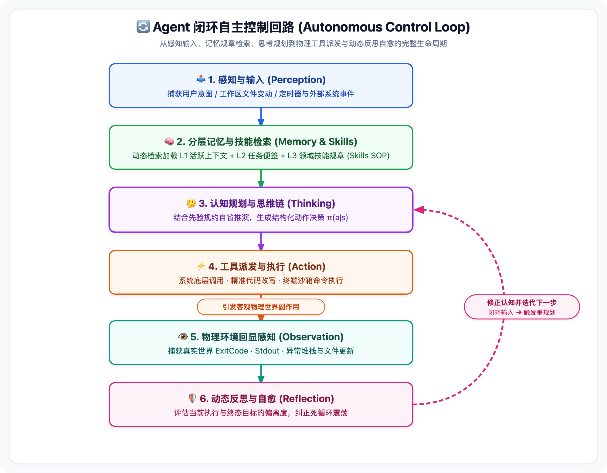
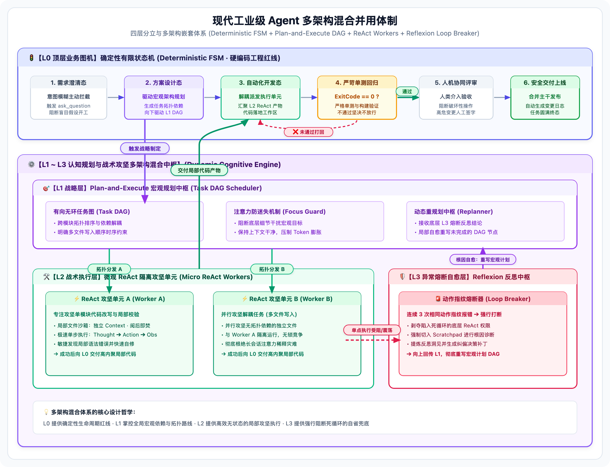

> [📖 返回手册总目录](../README.md) | [← 返回总目录](../README.md) | [下一章：02_7大Step_Types生产级Schema全解.md →](02_7大Step_Types生产级Schema全解.md)\n\n---\n\n## 第 1 章：Agent 的本质与执行循环：LLM vs Agent 与多架构混合并用体制

### 1.1 小白入门通俗理解：什么是 LLM？什么是 Agent？

如果你是一个完全没接触过智能体的小白，可以把大语言模型（LLM）和智能体（Agent）理解为以下两个经典物理形象：

* **大语言模型（LLM）＝“被锁在无菌密室里的超级天才大脑”**：
  * 他极度聪明，博览群书，天文地理无所不知；
  * **但是他没有手、没有脚、没有眼睛、没有耳朵，更没有自己的手表**；
  * 他只能坐在密室桌子前，看别人从门缝里塞进来的一张小纸条（Prompt），然后自言自语地在另一张纸条上写出下一串字符（Next-Token 预测），随后写完纸条，他瞬间被施加遗忘魔法，**完全进入关机状态**；
  * 他哪怕写出了“我已经把 Bug 修复了”，他在现实物理世界里**什么都没有做**，代码文件依然躺在你的硬盘上原封不动。
* **智能体（Agent）＝“给超级大脑装配了手脚、眼睛、专业技能手册、笔记本和自律神经回路”**：
  * **眼睛与耳朵（Perception / Sensors）**：Agent 可以调用只读工具去查看屏幕、阅读文件、接收用户的敲键输入与后台报错；
  * **手与脚（Action / Tools）**：Agent 可以调用操作系统底层的系统调用，敲击键盘执行终端命令（如 `git commit`、`npm test`），直接写入你的物理磁盘（**赋予做动作的原子物理能力**）；
  * **专业技能手册（Skills / 专家 SOP 规程）**：如果只给大脑发工具，大模型就像拿了扳手却乱拆零件的实习生。Skills 外挂了特定业务领域的“专家标准作业程序”（如短剧分镜镜头连贯性军规、微服务安全防注入规约），指导手脚“按工业规矩把事情做对”（**传授领域专家的做事手艺与规矩**）；
  * **专属笔记本（Memory Architecture）**：跨越单次会话的限制，把做过的尝试、失败的教训、长期任务便签忠实记录下来；
  * **自律神经回路（Event Loop / Control Loop）**：大脑思考一步后，手脚去执行；执行产生的结果（报错或成功）立即通过眼睛反馈给大脑，大脑看到报错后自己反思、自己修正，周而复始，直到目标完全达成。

#### 💡 小白必读避坑：有了 Tools（工具），为什么还需要 Skills（技能）？

许多初学者最容易混淆 **Tool（工具）** 与 **Skill（技能）**。在工业级智能体架构中，二者有着明确的分立定位：

| 维度 | LLM（大语言模型） | Tool（工具 / 原子武器库） | Skill（技能 / 专家 SOP） | Agent（智能体完整形态） |
| :--- | :--- | :--- | :--- | :--- |
| **经典物理形象** | **无菌密室里的天才大脑** | **工匠手里的扳手、螺丝刀** | **专业设备的检修手册与作业规约** | **持证上岗的特种作业总工程师** |
| **核心职责** | 提供通识认知与逻辑推理 | 提供与物理世界交互的原子操作能力 | 约束业务流程、传授领域经验与避坑军规 | 闭环感知、自主决策并达成复杂终态目标 |
| **典型实例** | GPT-4、Claude 3.5、Gemini | `run_command`、`read_file`、`replace_file_content` | `commercial-short-drama`（短剧分镜 SOP）、`git-workflow` | Antigravity、Claude Code、Devin |
| **缺少它的后果** | 无法思考，系统退化为死板脚本 | 无法行动，只能“在纸面上纸上谈兵” | 乱用工具，凭盲目常识碰运气甚至搞崩生产 | 无法自主闭环完成复杂任务 |

> 📌 **核心认知金句**：  
> **Tool 赋予智能体“做动作的物理能力”（能不能敲命令）；**  
> **Skill 传授智能体“把事情做对的专家手艺”（该怎么按业务规范精准敲命令）。**  
> *注：在工业体系中，Skills 不会一开始全量塞入 Prompt 撑爆上下文，而是通过**渐进式披露（Progressive Disclosure）**按需挂载（详见[第 4 篇：规章与Skills模块化工程](../04_规章与Skills模块化工程/README.md)）。*

从控制论（Cybernetics）的数学定义来看：
$$\text{Agent} = \langle S, A, P, M, T \rangle$$

* **$S$（状态 State）**：当前工作区、文件树、任务便签与上下文历史；
* **$A$（动作空间 Action/Tools）**：操作系统调用、文件读写、终端命令；
* **$P$（认知规划器 Planner/LLM）**：分析现状并结合规约输出决策策略 $\pi(a \mid s)$；
* **$M$（记忆与技能体系 Memory & Skills）**：跨越短期上下文限制的分层知识库与动态注入的 L3 专家规程（Skills）；
* **$T$（环境转移与感知 Transition & Observation）**：工具在物理世界引发的副作用（ExitCode, Stdout）反馈回状态机。



---

### 1.2 经典主流 Agent 架构的深度技术剖析

在智能体演进史上，出现过多种认知架构范式。每一种架构都有其高光时刻，也有其致命软肋：

#### 1. ReAct 架构（Reasoning + Acting：思考与行动循环）
* **核心运行思想**：每一次决策只做两件事——“我想（Thought）”与“我做（Action）”。执行后拿到“我看（Observation）”，紧接着再做下一个“我想”与“我做”。
* **单步执行流**：
  ```text
  Thought: 用户说订单接口报 500 错误，我需要先查看 server.py 的异常处理函数。
  Action: view_file(path="server.py", StartLine=120, EndLine=160)
  Observation: [行 145: except ZeroDivisionError: return 500]
  Thought: 找到了，除零异常导致了 500，我应该加上除数判空逻辑。
  Action: replace_file_content(...)
  Observation: [替换成功，文件已更新]
  ```
* **优点**：反应极快、动态适应性极强。在排查单点报错、简单答疑时非常丝滑。
* **致命缺陷（为什么单靠 ReAct 会死）**：
  * **管窥效应（Tunnel Vision）**：就像在伸手不见五指的黑夜里摸索，走一步看一步。面对需要重构 50 个文件的跨模块任务，ReAct 完全没有全局路线图；
  * **注意力迷失与上下文爆炸**：每一次 Thought/Action/Observation 都在成倍消耗 Token。执行到第 15 步时，模型早已忘了一开始要达成的终极目标是什么，极易在局部细枝末节中陷入无休止的“原地踏步”。

#### 2. Plan-and-Execute / Plan-and-Solve 架构（规划与执行分离）
* **核心运行思想**：将“战略制定”与“战术执行”彻底解耦。
  * **第一阶段（Planner 规划器）**：LLM 宏观审视全局目标，输出一份结构化的步骤清单（Step 1, Step 2, Step 3...）或任务依赖 DAG 图；
  * **第二阶段（Executor 执行器）**：调度器按顺序或并发调用执行器逐一完成任务；
  * **第三阶段（Replanner 动态重规划）**：当某个步骤出现预期之外的阻碍时，重新唤醒规划器重构后续计划。
* **优点**：全局视野极佳，任务执行条理清晰，多任务依赖关系一目了然，执行过程大幅节约思考 Token。
* **致命缺陷**：过于僵硬。物理世界充满变数，如果第一步探索就发现前置假设完全错误，预先规划的 10 个步骤瞬间全盘作废。

---

### 1.3 现代工业级 Agent 的多架构混合并用体制

在长达数小时、涉及复杂生产工程重构的工业级真实场景中，**单一架构必死无疑**！  
顶尖工业系统（如 Antigravity、Claude Code、Devin）采用 **“四层分立与多架构嵌套体系”**：



#### 四层职责的精炼分工：
1. **L0 确定性业务状态机（Deterministic FSM）**：用硬编码 Python 代码控制流锁死业务红线。**未通过单元测试，代码绝对无法流转到部署节点**；遇到二义性输入，状态机强制阻断并弹出 `ask_question` 询问人类；
2. **L1 战略规划层（Plan-and-Solve）**：宏观战略指挥部，负责跨模块依赖分析，输出高内聚、低耦合的任务有向无环图（Task DAG）；
3. **L2 微观战术单元（Micro-ReAct Worker）**：微观攻坚步兵。每个子任务实例化一个独立的短生命周期 ReAct 循环，**只注入当前子任务所需的局部上下文，执行完毕后将其产物提炼为高密结果，随后彻底销毁该 ReAct 的完整历史**，从而保证主系统上下文永远轻盈；
4. **L3 异常反思自愈层（Reflexion Engine）**：检测到动作指纹震荡（如连续 3 次试图修复同一个报错未果）时，强制打断 ReAct，要求模型在 Scratchpad 中口头反思失败根因，并触发 L1 重新制定 DAG。

---

### 1.4 工业级多架构混合引擎完整 Python 实现原型

以下源码展示了工业级 Agent 如何在生产中将确定性 FSM、Plan-and-Solve 战略中枢、微观 ReAct 隔离单元与 Reflexion 熔断自愈无缝结合：

```python
from typing import List, Dict, Any, Optional
from enum import Enum
import hashlib

class SystemState(Enum):
    CLARIFICATION = "CLARIFICATION"  # 需求澄清态
    PLANNING = "PLANNING"            # 战略规划态
    EXECUTION = "EXECUTION"          # 战术执行态
    TESTING = "TESTING"              # 单测验证态
    REVIEW = "REVIEW"                # 交付评审态

class TaskNode:
    def __init__(self, task_id: str, description: str, target_file: str):
        self.task_id = task_id
        self.description = description
        self.target_file = target_file
        self.status = "PENDING"  # PENDING, RUNNING, COMPLETED, FAILED

class IndustrialHybridAgent:
    def __init__(self):
        self.state = SystemState.CLARIFICATION
        self.task_dag: List[TaskNode] = []
        self.recent_fingerprints: List[str] = []
        self.max_repeated_attempts = 3

    def run_lifecycle(self, user_goal: str):
        print(f"[*] 启动工业级混合引擎，初始目标: {user_goal}")
        
        while self.state != SystemState.REVIEW:
            if self.state == SystemState.CLARIFICATION:
                # L0 门禁: 检查意图是否含糊不清
                if self._check_ambiguity(user_goal):
                    print("[L0 拦截] 意图不明确，挂起状态机，调用 ask_question 交互模态框")
                    return "WAITING_FOR_USER_CLARIFICATION"
                self.state = SystemState.PLANNING

            elif self.state == SystemState.PLANNING:
                # L1 战略规划层: 生成全局 Task DAG
                print("[L1 规划] 生成跨文件任务 DAG 规划图...")
                self.task_dag = [
                    TaskNode("T1", "重构数据接入接口", "api/datasource.py"),
                    TaskNode("T2", "补充业务校验逻辑", "services/validator.py"),
                    TaskNode("T3", "编写全链路单测", "tests/test_flow.py")
                ]
                self.state = SystemState.EXECUTION

            elif self.state == SystemState.EXECUTION:
                # L2 战术执行层: 实例化微观 ReAct 独立单元攻坚
                for task in self.task_dag:
                    if task.status == "COMPLETED":
                        continue
                    print(f"[L2 ReAct] 启动隔离单元处理子任务: {task.task_id} -> {task.target_file}")
                    success = self._run_micro_react_worker(task)
                    
                    if not success:
                        print(f"[L3 熔断] 子任务 {task.task_id} 遭遇连续阻碍，触发 Reflexion 口头反思！")
                        self.state = SystemState.PLANNING  # 打回战略层重构计划
                        break
                    task.status = "COMPLETED"
                else:
                    self.state = SystemState.TESTING

            elif self.state == SystemState.TESTING:
                # L0 确定性业务红线: 必须 ExitCode == 0
                test_passed = self._run_hard_coded_tests()
                if test_passed:
                    print("[L0 验证] 单测 100% 通过，流转至人工评审态")
                    self.state = SystemState.REVIEW
                else:
                    print("[L0 警告] 单测未通过，硬性打回执行态重构！")
                    self.state = SystemState.EXECUTION

        print("[*] 任务圆满完成，进入最终交付！")
        return "SUCCESS"

    def _check_ambiguity(self, goal: str) -> bool:
        return len(goal.strip()) < 5

    def _run_micro_react_worker(self, task: TaskNode) -> bool:
        # 微观 ReAct 循环，带动作指纹检测 (Loop Breaker)
        for turn in range(5):
            action_code = f"edit_{task.target_file}_turn_{turn}"
            fingerprint = hashlib.md5(action_code.encode()).hexdigest()
            self.recent_fingerprints.append(fingerprint)
            
            # 检测是否陷入死循环
            if self.recent_fingerprints.count(fingerprint) >= self.max_repeated_attempts:
                return False  # 触发失败熔断
        return True

    def _run_hard_coded_tests(self) -> bool:
        # 实际生产中调用 pytest 或专用测试套件
        return True
```\n\n---\n\n> [← 返回总目录](../README.md) | [📖 返回手册总目录](../README.md) | [下一章：02_7大Step_Types生产级Schema全解.md →](02_7大Step_Types生产级Schema全解.md)\n