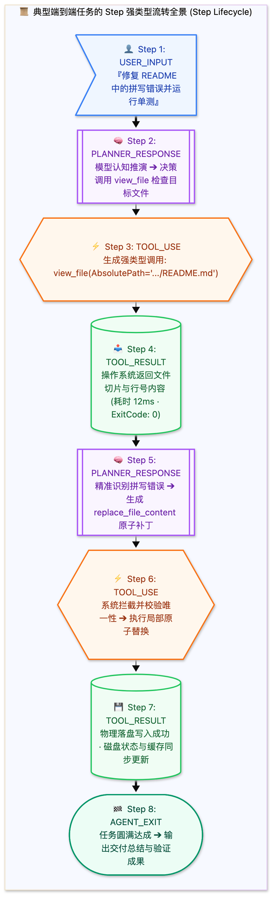

> [📖 返回手册总目录](../README.md) | [← 上一章：01_Agent本质与多架构混合体制.md](01_Agent本质与多架构混合体制.md) | [下一章：03_全生命周期轨迹Trajectory建模.md →](03_全生命周期轨迹Trajectory建模.md)\n\n---\n\n## 第 2 章：运行时的最小原子：7 大 Step Types 生产级 Schema 全解

### 2.1 小白入门通俗理解：为什么不能用普通的聊天记录？

初学者在制作第一个 AI Demo 时，通常直接把用户的提问和模型的回答拼成一个 `messages: [{"role": "user", "content": "..."}, {"role": "assistant", "content": "..."}]` 数组。  
但在真实的工业级 Agent 运行时中，**这种做法在第一天就会彻底崩溃**：
1. **多维度异构信息混杂**：大模型的内心推演（思维链 `thinking`）、给用户的最终说明文本（`content`）、想调用的工具（`tool_calls`）、工具执行的真实系统退出码（`exit_code`）以及标准输出（`stdout`），如果全揉成一个字符串，后续系统根本无法做权限拦截、性能监控与自动化重试；
2. **缺乏状态机确定性**：系统必须清楚地知道当前是“该等用户输入”、“该等工具返回”，还是“该唤醒超时定时器”；
3. **因果审计要求**：企业级安全合规要求记录每一次系统调用的精确毫秒耗时、操作员身份和退出码。

因此，工业级 Agent 将运行历史建模为一个由**离散事件（Discrete Events）构成的事件序列**，每一个事件被称为一个 **Step（步骤）**。



---

### 2.2 7 大生产级 Step Types 强类型架构与 Schema 全解

在生产级 Agent 内核中，所有 Step 都继承自统一的 `StepBase` 强类型结构：

```json
{
  "$schema": "https://json-schema.org/draft/2020-12/schema",
  "title": "StepBase",
  "type": "object",
  "required": ["step_index", "step_id", "source", "type", "status", "created_at"],
  "properties": {
    "step_index": { "type": "integer", "description": "全局单调自增步序号，从 1 开始" },
    "step_id": { "type": "string", "description": "全局唯一 UUIDv4" },
    "source": { "type": "string", "enum": ["USER_EXPLICIT", "MODEL", "SYSTEM", "SUBAGENT"] },
    "type": { "type": "string", "enum": ["USER_INPUT", "PLANNER_RESPONSE", "TOOL_USE", "TOOL_RESULT", "INTERACTION_REQUEST", "SYSTEM_EVENT", "AGENT_EXIT"] },
    "status": { "type": "string", "enum": ["RUNNING", "DONE", "ERROR", "SUSPENDED"] },
    "created_at": { "type": "string", "format": "date-time" }
  }
}
```

#### 1. `USER_INPUT`（用户输入 / 外部触发源）
* **工程职责**：整个自主控制循环的根触发点。支持携带多模态附件（图片、文档引用）和上下文元数据。
* **真实生产 JSON 样例**：
  ```json
  {
    "step_index": 1,
    "step_id": "step-9a8f-001",
    "source": "USER_EXPLICIT",
    "type": "USER_INPUT",
    "status": "DONE",
    "created_at": "2026-10-17T10:00:00.120Z",
    "content": "请检查当前项目的依赖安全性，并修复所有可自动升级的漏洞。",
    "media": []
  }
  ```

#### 2. `PLANNER_RESPONSE`（大模型认知规划响应）
* **工程职责**：大模型完成一次自回归采样后的产物。**核心实现了思维链（`thinking`）与面向用户回答（`content`）以及外部动作声明（`tool_calls`）的严密物理三权分立**。
* **真实生产 JSON 样例**：
  ```json
  {
    "step_index": 2,
    "step_id": "step-9a8f-002",
    "source": "MODEL",
    "type": "PLANNER_RESPONSE",
    "status": "DONE",
    "created_at": "2026-10-17T10:00:03.450Z",
    "thinking": "用户希望检查依赖安全。我应该先运行 pip audit 或 safety check 查看已知的 CVE 漏洞报告。",
    "content": "好的，我现在为您运行项目依赖安全审计。",
    "tool_calls": [
      {
        "tool_call_id": "call_audit_01",
        "name": "run_command",
        "parameters": {
          "CommandLine": "safety check --json",
          "Cwd": "/workspace/project",
          "WaitMsBeforeAsync": 5000
        }
      }
    ]
  }
  ```

#### 3. `TOOL_USE`（工具调用准备分发）
* **工程职责**：系统将模型的 `tool_calls` 转化为实际执行调度任务的前置事件。**这是触发生命周期 Hook 安全拦截器的唯一挂载点**。如果 Hook 判定为 `deny`，该 Step 状态直接被覆写为 `ERROR`，且后续物理命令绝对不会发射到操作系统。

#### 4. `TOOL_RESULT`（物理执行结果回显）
* **工程职责**：工具在操作系统或网络微服务执行后的物理回显，作为下一次模型思考的 `Observation`。
* **真实生产 JSON 样例**：
  ```json
  {
    "step_index": 4,
    "step_id": "step-9a8f-004",
    "source": "SYSTEM",
    "type": "TOOL_RESULT",
    "status": "DONE",
    "created_at": "2026-10-17T10:00:05.890Z",
    "tool_call_id": "call_audit_01",
    "exit_code": 0,
    "duration_ms": 2440,
    "output": "Found 1 vulnerability in package 'urllib3' (CVE-2023-45803). Recommend update to >=2.0.7."
  }
  ```

#### 5. `INTERACTION_REQUEST`（人机交互中断态）
* **工程职责**：当遇到高危操作（如清空数据库）或需求二义性时，Agent 自主调用 `ask_question`。此时进程彻底挂起，内存保存当前状态机上下文，前端渲染交互控件等待人类选择。

#### 6. `SYSTEM_EVENT`（系统外部脉冲）
* **工程职责**：代表非模型主动触发的系统级事件。例如：后台长任务运行结束唤醒、定时 Cron 触发、或者上下文消耗达到 80% 触发系统自动压缩（Compaction）。

#### 7. `AGENT_EXIT`（正常或异常终止态）
* **工程职责**：生命周期的终结标识。记录本次会话的消耗总 Token、执行耗时、最终达成状态（SUCCESS / FAILED / TIMEOUT）。\n\n---\n\n> [← 上一章：01_Agent本质与多架构混合体制.md](01_Agent本质与多架构混合体制.md) | [📖 返回手册总目录](../README.md) | [下一章：03_全生命周期轨迹Trajectory建模.md →](03_全生命周期轨迹Trajectory建模.md)\n