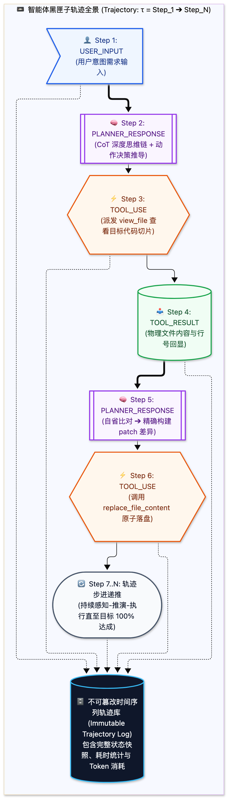
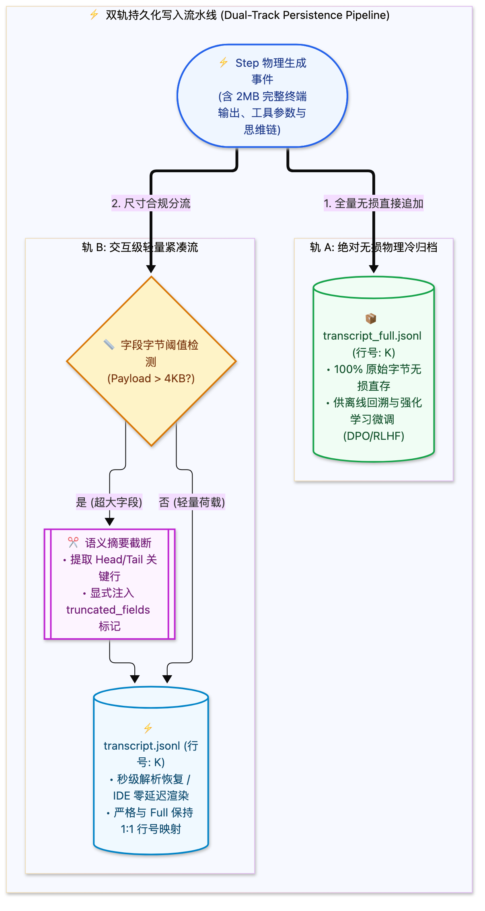

> [📖 返回手册总目录](../README.md) | [← 上一章：02_7大Step_Types生产级Schema全解.md](02_7大Step_Types生产级Schema全解.md) | [下一章：04_核心工具集底层执行机制.md →](../02_工具系统与工程实现/04_核心工具集底层执行机制.md)\n\n---\n\n## 第 3 章：全生命周期轨迹（Trajectory）：从 POMDP 状态序列到黑匣子双轨存储

### 3.1 小白入门通俗理解：什么是轨迹（Trajectory）？

如果把大语言模型比作**飞机的机长**，把各类工具比作**飞机的引擎、副翼与油门**，那么：
* **Trajectory（轨迹）就是整架飞机的“黑匣子飞行数据记录仪”（Flight Data Recorder）**。

在飞机平稳飞行时，黑匣子每分每秒都在以严格的时间戳记录机长的每一次指令、每一处操纵杆刻度、仪表盘的气压读数以及报警提示。  
* **为什么要黑匣子？**  
  一旦飞机遭遇气流颠簸或出现故障，工程师不会去猜“机长当时是怎么想的”，而是把黑匣子拆出来，逐帧回放所有物理参数。
* **在 AI 智能体中同理**：  
  如果一个 Agent 在连续工作 20 分钟后，突然把生产环境的数据库删了或者把核心代码改崩了，我们绝对不能只看它最后说的那句话，而是需要通过 **Trajectory 逐帧还原：在第几秒、读了什么文件、产生了什么错误逻辑推断、最终发出了什么错误指令**。

在强化学习与控制论（POMDP 部分可观测马尔可夫决策过程）中，轨迹定义为时间轴上的全量有序序列：
$$\tau = \Big( s_0, a_0, r_0, s_1, a_1, r_1, \dots, s_T \Big) \equiv \Big( \text{Step}_1, \text{Step}_2, \dots, \text{Step}_N \Big)$$



---

### 3.2 物理双轨制架构：`transcript.jsonl` vs `transcript_full.jsonl`

在大规模生产环境中，一个真实任务往往包含几十轮工具调用，产生数十兆的终端日志和大段思维链。如果把所有内容都无脑塞进单条日志文件中，会导致 IDE 插件卡死、文件检索缓慢。工业级 Agent 设计了精妙的 **“双轨制存储架构”**：

| 特性维度 | 轻量紧凑轨迹 (`transcript.jsonl`) | 无损全量轨迹 (`transcript_full.jsonl`) |
| :--- | :--- | :--- |
| **存储格式** | JSON Lines (每行一个单步 JSON) | JSON Lines (严格与 compact 保持行号 1-1 映射) |
| **体积控制** | 严格限制。大文本自动截断为概要 | 100% 原始字节流无损持久化 |
| **截断标记** | 显式标注 `"truncated_fields": ["content"]` | 无任何截断，原始忠实记录 |
| **典型使用场景** | 日常会话展示、状态机轮巡、秒级历史恢复 | 深水区排错、离线回溯、专家轨迹微调 (DPO/SFT) |



---

### 3.3 时间旅行回放与故障复盘实战（Python 实现）

以下源码展示了如何利用 Trajectory 实现**确定性时间旅行重放（Time-Travel Replay）**。无论是用于离线排查 Bug，还是用于从挂掉的步骤原地恢复执行：

```python
import json
import os
from typing import Generator, Dict, Any, Optional

class TrajectoryEngine:
    def __init__(self, log_dir: str):
        self.compact_path = os.path.join(log_dir, "transcript.jsonl")
        self.full_path = os.path.join(log_dir, "transcript_full.jsonl")

    def read_trajectory(self, step_limit: Optional[int] = None) -> Generator[Dict[str, Any], None, None]:
        """逐步重放轨迹事件，遇到被截断字段自动从 full 流定向补齐"""
        if not os.path.exists(self.compact_path):
            return

        with open(self.compact_path, "r", encoding="utf-8") as f_compact, \
             open(self.full_path, "r", encoding="utf-8") as f_full:
            
            for line_no, (c_line, f_line) in enumerate(zip(f_compact, f_full), start=1):
                if step_limit and line_no > step_limit:
                    break
                
                step_data = json.loads(c_line)
                
                # 如果发现该 Step 存在被截断字段，精确从 full 流解析补齐
                if "truncated_fields" in step_data and step_data["truncated_fields"]:
                    full_step_data = json.loads(f_line)
                    for field in step_data["truncated_fields"]:
                        step_data[field] = full_step_data.get(field)
                
                yield step_data

    def time_travel_inspect(self, target_step_index: int):
        """时间旅行: 瞬间定位到第 K 步的状态快照"""
        print(f"[*] 启动时间旅行，回溯至 Step {target_step_index}...")
        for step in self.read_trajectory(step_limit=target_step_index):
            if step["step_index"] == target_step_index:
                print(f"[命中快照] 类型: {step['type']} | 来源: {step['source']}")
                if "thinking" in step:
                    print(f"[机长内心推演]:\n{step['thinking']}")
                if "tool_calls" in step:
                    print(f"[发起的工具指令]:\n{json.dumps(step['tool_calls'], indent=2, ensure_ascii=False)}")
                return step
        print(f"[!] 找不到 Step {target_step_index}")
        return None
```\n\n---\n\n> [← 上一章：02_7大Step_Types生产级Schema全解.md](02_7大Step_Types生产级Schema全解.md) | [📖 返回手册总目录](../README.md) | [下一章：04_核心工具集底层执行机制.md →](../02_工具系统与工程实现/04_核心工具集底层执行机制.md)\n