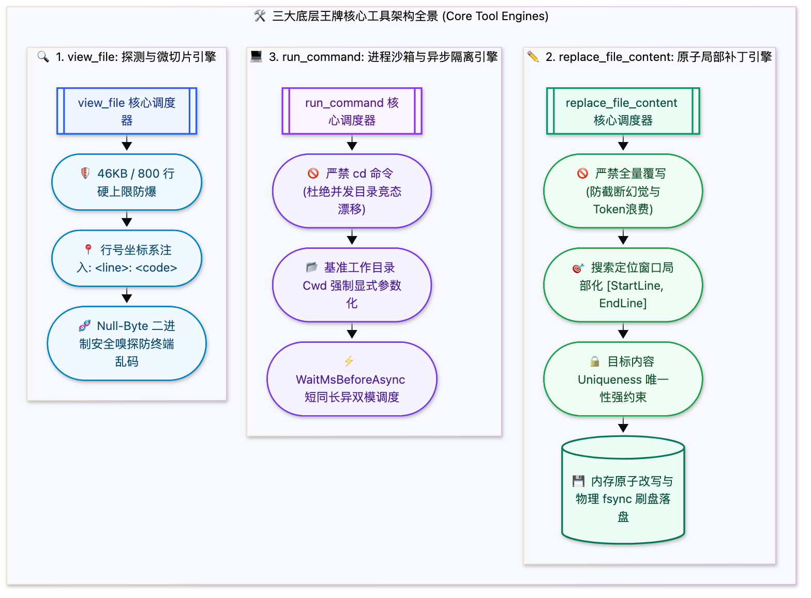

> [📖 返回手册总目录](../README.md) | [← 上一章：03_全生命周期轨迹Trajectory建模.md](../01_认知核心与运行循环/03_全生命周期轨迹Trajectory建模.md) | [下一章：05_工具安全分级与并发执行管道.md →](05_工具安全分级与并发执行管道.md)\n\n---\n\n## 第 4 章：核心工具集（Core Tools）：`view_file`、`replace_file_content` 与 `run_command` 底层执行

### 4.1 小白入门通俗理解：什么是核心工具（Core Tools）？

如果把智能体比作一个外科医生：
* **扩展工具（Plugins / MCP Tools）** 就像医院里的各种外接化验设备（CT 机、核磁共振、血液分析仪），需要开机、连网线、按需调用；
* **核心工具（Core Tools）** 就像医生自己的**双手、双眼和止血钳**。它们是操作系统内建的、绝对不能断网、绝对不能宕机的**基础本能**。

如果一个智能体的核心工具设计拙劣（例如一读文件就读死内存，一改文件就改错行），那么不管背后的大模型智商有多高，都会瞬间变成“眼瞎手抖的庸医”，引发严重的生产事故。

---

### 4.2 三大王牌核心工具底层源码级执行机制



#### 1. `view_file`：微切片与防内存爆炸机制
大文件是上下文窗口与推理引擎的头号杀手。如果允许智能体一次性读取一个 20MB 的 SQLite 文件或数万行日志，整个会话将因 Token 超限瞬间崩溃。
* **46KB / 800 行硬限制**：单次读取施加严格硬限制（`MAX_BYTES = 46080`，`MAX_LINES = 800`）。超限时强制截断并返回继续分页指引；
* **行号前缀注入（Line Number Injection）**：**这是所有 Coding Agent 最核心的秘密**！`view_file` 返回给大模型的内容，每一行前面必须强制拼上 `<line_number>: <original_line>`。因为大模型没有物理眼球，如果没有行号，它在后续发起代码修改时根本无法知道目标行是多少；
* **基于行号的切片（1-Indexed Line Slice）**：通过 `StartLine` 与 `EndLine` 精确指定读取范围，底层通过行偏移索引表（Line Offset Index）实现 $O(1)$ 复杂度直接 Seek；
* **`ContentOffset` 字节流分页**：面对单行极端超长（如压缩前端 JS 或高维向量），自动降级为字节偏移分页；
* **二进制空字符（Null Byte `\0`）嗅探**：读取前 512 字节自动探测媒体与二进制文件，严禁向文本流倾倒乱码。

#### 2. `replace_file_content`：单连续块精确替换与原子事务
为什么在工业级代码智能体中，**严厉禁止大模型全量覆盖（Full-file Overwrite）写文件**？
1. **上下文与成本巨大浪费**：改动 1 行代码却要模型重写 2000 行，产生巨大 Token 消耗与数十秒延迟；
2. **“偷懒截断”导致代码损毁**：大模型生成大段代码时极度容易偷懒输出 `// ... 其余代码保持不变 ...`，如果此时系统执行全量覆盖写入，你的生产源码将瞬间被腰斩损毁！

`replace_file_content` 核心规则与 Python 实现算法：
* **单连续块原则（Single Contiguous Chunk）**：一次调用只改动一段连续代码；
* **局部搜寻窗口（StartLine & EndLine）**：限制搜索范围，提升替换效率；
* **唯一性匹配校验（Uniqueness Constraint）**：在指定行范围内，`TargetContent` 必须在目标文件中**绝对唯一**存在。若存在两处及以上相同代码且未开启 `AllowMultiple`，系统直接抛出拦截异常，强迫模型缩小行号范围，彻底消除改错位置的隐患。

```python
def replace_file_content(target_file: str, start_line: int, end_line: int, 
                         target_content: str, replacement_content: str, 
                         allow_multiple: bool = False) -> str:
    with open(target_file, "r", encoding="utf-8") as f:
        lines = f.readlines()
    
    total_lines = len(lines)
    if not (1 <= start_line <= end_line <= total_lines):
        raise ValueError(f"行号越界: 目标文件共 {total_lines} 行，指定范围 [{start_line}, {end_line}] 无效")
    
    # 提取搜索窗口内的文本
    window_lines = lines[start_line - 1 : end_line]
    window_text = "".join(window_lines)
    
    # 唯一性校验
    match_count = window_text.count(target_content)
    if match_count == 0:
        raise ValueError("在指定行号窗口内未找到与 target_content 精确匹配的代码块，请重新 view_file 核实")
    if match_count > 1 and not allow_multiple:
        raise ValueError(f"在行号 [{start_line}, {end_line}] 内发现了 {match_count} 处相同匹配！为防误伤，请进一步缩小行号范围。")
    
    # 执行内存精准替换
    new_window_text = window_text.replace(target_content, replacement_content, 1 if not allow_multiple else -1)
    
    # 原子拼接回全量文件
    new_full_lines = lines[: start_line - 1] + [new_window_text] + lines[end_line:]
    
    # 原子写入磁盘 (写入临时文件并原子 rename)
    tmp_file = f"{target_file}.antigravity_tmp"
    with open(tmp_file, "w", encoding="utf-8") as f:
        f.writelines(new_full_lines)
    os.replace(tmp_file, target_file)
    
    return f"成功原子替换 {target_file} 第 {start_line} 至 {end_line} 行的内容。"
```

#### 3. `run_command`：命令执行子系统与进程隔离
* **绝对禁止 `cd` 命令**：多线程并发下全局进程工作目录共享会导致路径污染。工业级 Agent 要求必须通过显式的 `Cwd` 参数指定每次命令的基准执行目录；
* **同步等待与异步守护（WaitMsBeforeAsync & IsDaemon）**：短命令（如 `git status`）同步等待 5 秒直接返回结果；长服务（如 `npm run dev`）设 `IsDaemon=true`，系统立即分配全局唯一 `task_id` 转入后台 Daemon 托管，后续通过 `manage_task` 交互；
* **持久化终端通道（RunPersistent）**：支持跨调用的持久化会话，共享 Python Virtualenv 等环境状态。\n\n---\n\n> [← 上一章：03_全生命周期轨迹Trajectory建模.md](../01_认知核心与运行循环/03_全生命周期轨迹Trajectory建模.md) | [📖 返回手册总目录](../README.md) | [下一章：05_工具安全分级与并发执行管道.md →](05_工具安全分级与并发执行管道.md)\n