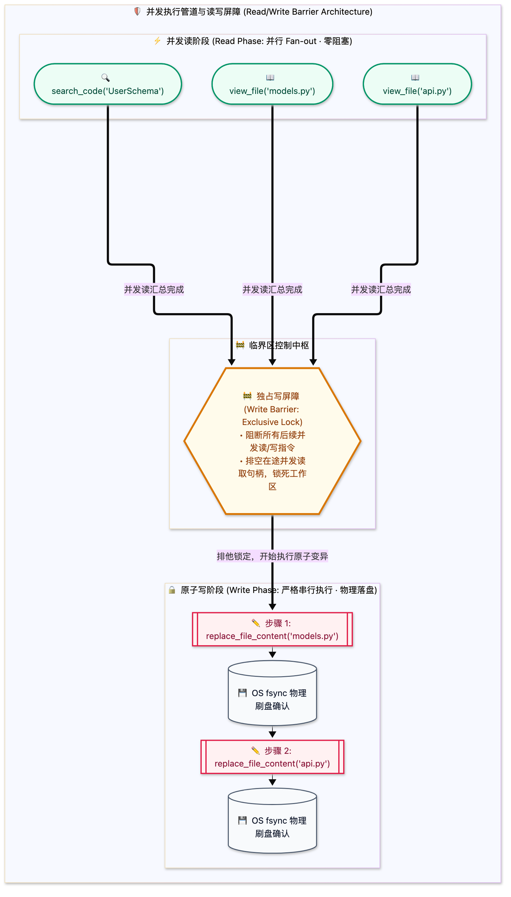

> [📖 返回手册总目录](../README.md) | [← 上一章：04_核心工具集底层执行机制.md](04_核心工具集底层执行机制.md) | [下一章：06_惰性工具Lazy_Tools三重态.md →](06_惰性工具Lazy_Tools三重态.md)\n\n---\n\n## 第 5 章：工具安全分级与并发执行管道：Read/Write 隔离与并行调度

### 5.1 小白入门通俗理解：读写屏障（Read/Write Barrier）

在操作系统与数据库中，有一个经典的法则：**“允许多个人同时看书，但绝不允许两个人同时在一页纸上乱涂乱画”**。  
在智能体执行环境中同理：
* **纯只读工具（Read-Only）**：如 `view_file`、`search_code`、`git status`。它们不会对物理世界产生破坏性副作用。如果 Agent 想要同时查看 5 个配置文件，我们完全没有必要傻傻地“看完一个再看下一个”，而是可以像八爪鱼一样**一瞬间并发读取 5 个文件**（Fan-out 并行）；
* **破坏性写操作（Mutating / Write）**：如 `replace_file_content`、`write_to_file`、`rm -rf`。一旦两个改写命令同时发往同一个文件，文件内容必将错乱损毁。因此，写操作必须像“过收费站”一样，拉起**写屏障（Write Barrier）**，所有读操作必须等待写操作完成并落盘后才能继续。

---

### 5.2 生产级工具分级安全矩阵

| 安全级别 | 工具代表 | 并发许可 | 审批门禁 | 沙箱要求 |
| :--- | :--- | :--- | :--- | :--- |
| **L0 纯只读 (Read-Only)** | `view_file`, `search_code`, `read_url` | 允许高并发 (Fan-out) | 无需人类审批 | 本地只读文件系统映射 |
| **L1 局部写 (Safe Write)** | `replace_file_content`, `write_to_file` | 严格串行 (排队锁) | 触发 Hook 语法检查 | 本地工作区白名单内 |
| **L2 系统命令 (Shell Exec)** | `run_command(pytest, git status)` | 串行/受限并发 | 匹配白名单命令放行 | 限制环境变量，严禁提权 |
| **L3 高危物理破坏 (Dangerous)** | `rm -rf`, `DROP TABLE`, `git push --force` | 禁止自动化并发 | **强行阻断，必须人类确认 (Ask)** | Docker 隔离沙箱 / 虚拟容器 |\n\n---\n\n> [← 上一章：04_核心工具集底层执行机制.md](04_核心工具集底层执行机制.md) | [📖 返回手册总目录](../README.md) | [下一章：06_惰性工具Lazy_Tools三重态.md →](06_惰性工具Lazy_Tools三重态.md)\n