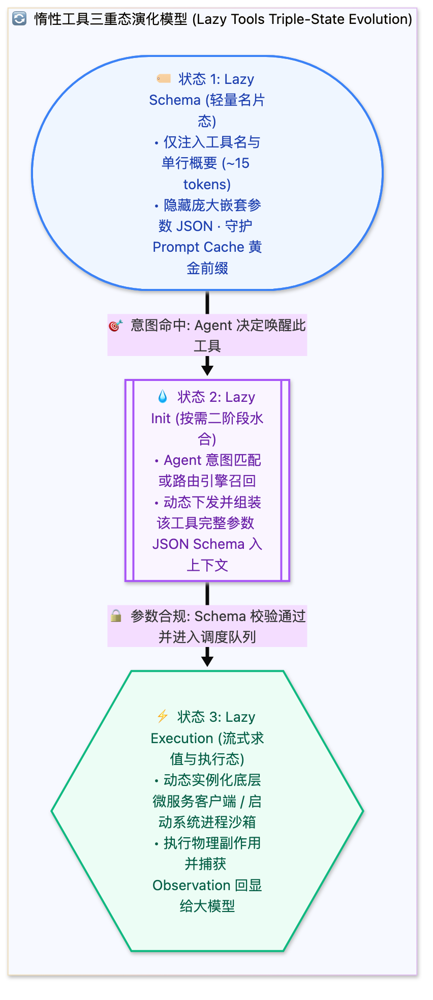

> [📖 返回手册总目录](../README.md) | [← 上一章：05_工具安全分级与并发执行管道.md](05_工具安全分级与并发执行管道.md) | [下一章：07_高阶工具范式元工具与宏工具.md →](07_高阶工具范式元工具与宏工具.md)\n\n---\n\n## 第 6 章：惰性工具（Lazy Tools）三重态深度解密：Lazy Schema、Init 与 Execution

### 6.1 小白入门通俗理解：饭店菜单哲学

想象你走进一家拥有一千道特色菜的五星级大饭店：
* **传统粗暴做法（Eager Loading 饥饿加载）**：  
  服务员一上来，推着 10 辆小推车，把这一千道菜的**详尽炒菜秘籍、配料克数、火候控制表、主厨师承背景（每个工具几千字 JSON Schema）** 全都堆在你的餐桌上！  
  **结果**：餐桌当场被压塌（上下文窗口爆炸，几百 K tokens 全被工具参数吃光），你连菜单都翻不动，根本没法点餐。
* **现代工业级做法（Lazy Tools 惰性加载）**：  
  服务员只递给你一张轻便的小菜单（**Lazy Schema**）：上面只有菜名和一行精炼介绍（水煮鱼：麻辣鲜香；西红柿炒蛋：家常酸甜）。  
  当你伸手指向“水煮鱼”（**Agent 意图命中**），后厨才在后台把水煮鱼的详细调料配比和操作规程取出来（**Lazy Init**），最后厨师开火做菜（**Execution**）。

这就是 **惰性工具（Lazy Tools）** 的精髓：**“只在大模型需要用的时候，才把工具的完整参数结构水合注入上下文”**！



---

### 6.2 惰性工具三重态技术规格与 JSON 对比

#### 1. 状态一：Lazy Schema（轻量名片态）
在系统初始化时，注入大模型 System Prompt 的仅仅是工具的名片信息，一个工具仅占 15 ~ 20 Tokens：
```json
{
  "name": "deploy_kubernetes_cluster",
  "summary": "生产集群部署工具：支持创建命名空间、扩缩 Pod 与配置 Ingress",
  "is_lazy": true
}
```
**对比收益**：1000 个工具在饥饿加载下需要消耗约 **500,000 Tokens**，而在 Lazy Schema 模式下仅仅消耗 **15,000 Tokens**，**直接节约 97% 的上下文空间**！

#### 2. 状态二：Lazy Init（动态二阶段水合）
当 Agent 的思维链判断需要使用该工具时，向系统发出轻量水合请求：
```json
{
  "tool_call_id": "init_k8s_01",
  "name": "load_tool_schema",
  "parameters": { "tool_name": "deploy_kubernetes_cluster" }
}
```
引擎拦截该调用，在当前会话的上下文动态挂载该工具的真实完整 JSON Schema（包含 50 个复杂配置项），模型在下一个推理 Step 中即可填写强类型参数。

#### 3. 状态三：Lazy Execution（按需实例化与执行）
只有在模型真正发出参数调用时，系统才去建立数据库连接池、加载深度学习推理模型或初始化远程 gRPC 客户端。执行完毕后，长连接可设定空闲超时自动回收。

---

### 6.3 生产级 LazyToolRegistry 核心源码实现

```python
from typing import Dict, Any, Callable

class LazyToolDefinition:
    def __init__(self, name: str, summary: str, schema_loader: Callable[[], Dict[str, Any]], executor: Callable):
        self.name = name
        self.summary = summary
        self.schema_loader = schema_loader  # 延迟加载参数 Schema 的闭包
        self.executor = executor
        self.is_hydrated = False            # 是否已水合入上下文
        self._cached_schema = None

    def get_full_schema(self) -> Dict[str, Any]:
        if not self._cached_schema:
            self._cached_schema = self.schema_loader()
        self.is_hydrated = True
        return self._cached_schema

class LazyToolRegistry:
    def __init__(self):
        self._tools: Dict[str, LazyToolDefinition] = {}

    def register(self, name: str, summary: str, schema_loader: Callable[[], Dict[str, Any]], executor: Callable):
        self._tools[name] = LazyToolDefinition(name, summary, schema_loader, executor)

    def export_lightweight_declarations(self) -> list:
        """注入系统提示词的轻量名片集"""
        return [{"name": t.name, "summary": t.summary, "is_lazy": True} for t in self._tools.values()]

    def hydrate_tool(self, tool_name: str) -> Dict[str, Any]:
        """动态水合指定工具"""
        if tool_name not in self._tools:
            raise KeyError(f"未知的惰性工具: {tool_name}")
        return self._tools[tool_name].get_full_schema()

    def execute_tool(self, tool_name: str, **kwargs) -> Any:
        if tool_name not in self._tools:
            raise KeyError(f"未知的惰性工具: {tool_name}")
        return self._tools[tool_name].executor(**kwargs)
```\n\n---\n\n> [← 上一章：05_工具安全分级与并发执行管道.md](05_工具安全分级与并发执行管道.md) | [📖 返回手册总目录](../README.md) | [下一章：07_高阶工具范式元工具与宏工具.md →](07_高阶工具范式元工具与宏工具.md)\n