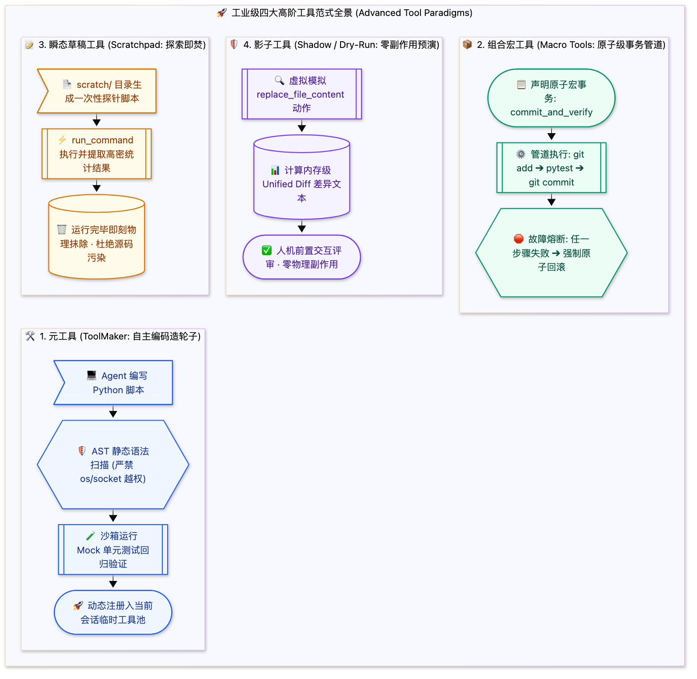

> [📖 返回手册总目录](../README.md) | [← 上一章：06_惰性工具Lazy_Tools三重态.md](06_惰性工具Lazy_Tools三重态.md) | [下一章：08_海量工具动态发现与两阶段路由.md →](08_海量工具动态发现与两阶段路由.md)\n\n---\n\n## 第 7 章：高阶工具范式：元工具（ToolMaker）、组合宏工具、瞬态草稿与影子工具

### 7.1 小白入门通俗理解：什么是高阶工具？

如果把普通工具（如 `view_file`、`replace_file_content`）比作现成买来的螺丝刀和扳手：
* **元工具（ToolMaker）** 就像一台 **“3D 打印机”**：当 Agent 发现手头的工具都不称手时，它自己写代码打印出一把全新的专用扳手，用完还可以融化回收；
* **组合宏工具（Macro Tools）** 就像格斗游戏里的 **“一键连招大招”**：把“看文件 ➔ 改代码 ➔ 跑单测 ➔ 提交代码”4 个连续步骤打包成一个原子按钮，按一下全自动执行；
* **瞬态草稿工具（Scratchpad Tools）** 就像 **“草稿纸”**：临时算个中间矩阵或解析个奇怪日志，算完直接把草稿纸撕掉烧毁，绝不弄脏正式档案；
* **影子工具（Shadow / Dry-Run Tools）** 就像 **“外科手术演练沙盘”**：真正动刀切除前，先在全真模型上试切一遍，看看会不会大出血。

---

### 7.2 四大高阶工具范式深度解密

#### 1. 元工具（ToolMaker）：智能体自主“造轮子”
在很多特异性任务中（如解析某种极其罕见的专用日志格式），系统不可能预先准备好现成工具。
* **流程**：Agent 使用 `write_to_file` 在沙箱目录编写 `custom_parser.py`；
* **安全门禁**：系统通过 AST 语法树检查其导入项，严禁 `import os`, `import socket` 等危险提权模块；
* **挂载与回收**：系统加载其实例，将其包装为一个只读工具动态注入 Agent 上下文。任务结束后立即从内存卸载。

#### 2. 组合宏工具（Macro Tools）：减少 80% 的决策轮次
大模型每调用一次工具，都需要经历完整的网络往返、上下文组装与自回归解码（消耗 5~15 秒）。如果执行常规流水线需要连续调用 6 次工具，用户需要等待近两分钟。
* **宏工具原理**：将一系列高频固定模式封装为一个原子宏。
* **事务回滚保证**：宏工具在执行前自动记录当前快照（`git stash` 或内存影子）。若第 3 步单测报错，宏工具自动回滚前两步的文件修改，向 Agent 汇报完整错误原因。\n\n---\n\n> [← 上一章：06_惰性工具Lazy_Tools三重态.md](06_惰性工具Lazy_Tools三重态.md) | [📖 返回手册总目录](../README.md) | [下一章：08_海量工具动态发现与两阶段路由.md →](08_海量工具动态发现与两阶段路由.md)\n