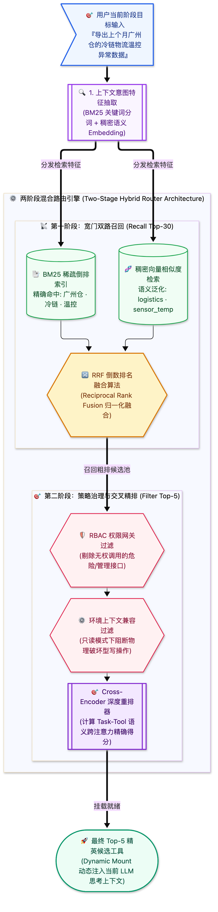

> [📖 返回手册总目录](../README.md) | [← 上一章：07_高阶工具范式元工具与宏工具.md](07_高阶工具范式元工具与宏工具.md) | [下一章：09_MCP标准协议架构与微服务集成.md →](09_MCP标准协议架构与微服务集成.md)\n\n---\n\n## 第 8 章：海量工具动态发现（Discovery）与两阶段混合路由

### 8.1 小白入门通俗理解：海量工具的“图书检索大厅”

当一个大企业的内部平台积累了 **5,000 多个 API 工具** 时：
* 如果把这 5,000 个工具一次性全灌进大模型，不仅上下文当场崩溃，大模型也会产生严重的“注意力失焦”，就像一个人眼前晃着五千只苍蝇，连最简单的指令都会看错；
* 解决这个问题的思路，就像你去国家图书馆借书：  
  大模型并不直接去书架上翻书，而是先走到 **“图书检索大厅”**。检索大厅先通过关键词和语义匹配，从 5000 本书中挑出最相关的 5 本，送到大模型的面前。

---

### 8.2 两阶段动态路由流水线（Two-Stage Hybrid Router）

#### 专职 Router Subagent 架构
在最前沿的体系中，工具路由甚至由一个专职的**只读轻量模型（如 Flash / Small Tier）** 独立承担。主 Agent 只需向 Router Agent 发送自然语言描述：“我需要查物流传感器数据，请给我对应工具”，Router Agent 秒级返回精炼工具句柄，主 Agent 上下文始终保持极致纯净。\n\n---\n\n> [← 上一章：07_高阶工具范式元工具与宏工具.md](07_高阶工具范式元工具与宏工具.md) | [📖 返回手册总目录](../README.md) | [下一章：09_MCP标准协议架构与微服务集成.md →](09_MCP标准协议架构与微服务集成.md)\n