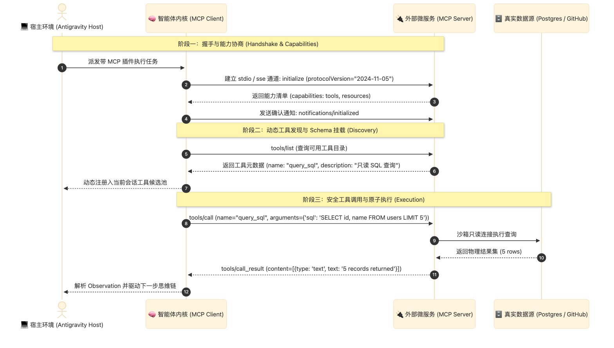

> [📖 返回手册总目录](../README.md) | [← 上一章：08_海量工具动态发现与两阶段路由.md](08_海量工具动态发现与两阶段路由.md) | [下一章：10_白盒工程控制与5大拦截点.md →](../03_生命周期Hook安全拦截/10_白盒工程控制与5大拦截点.md)\n\n---\n\n## 第 9 章：MCP（Model Context Protocol）标准协议架构与微服务集成

### 9.1 小白入门通俗理解：AI 时代的“Type-C 统一接口”

在没有统一标准之前，每个智能体框架都有自己私有的工具定义格式：
* LangChain 有一套 Tool 格式；
* AutoGen 有一套 Function 格式；
* OpenAI、Claude、Gemini 各自的 API 参数字段名称都不一样。
* 开发者每写一个数据库查询工具，如果要换个框架，就得全盘重写一遍适配层。

**MCP（Model Context Protocol，模型上下文协议）彻底终结了这种混乱局面**！  
MCP 就像数码硬件世界的 **Type-C 统一数据接口**：  
不管是 Postgres 数据库、GitHub、Slack、本地文件系统，还是自研的 ERP 软件，只要它实现了一套标准的 MCP Server，任何支持 MCP 的智能体（如 Antigravity、Claude Code）插上这根“线”，瞬间就能读取其数据、调用其功能！

---

### 9.2 MCP 双向 JSON-RPC 2.0 协议交互规范

MCP 底层完全基于标准的 **JSON-RPC 2.0** 协议，支持三种核心能力元原语：
1. **`Prompts`（提示词模版）**：Server 向 Agent 提供经过精心调优的专业指令模版；
2. **`Resources`（上下文资源）**：Server 向 Agent 暴露只读数据源（如同文件读取）；
3. **`Tools`（可执行工具）**：Server 向 Agent 暴露具有副作用的物理执行动作。

---

### 9.3 两种底层传输管道：Stdio vs SSE

工业级落地中，MCP Client 与 MCP Server 之间有两种标准传输模式：
1. **Stdio 模式（本地进程标准输入输出）**：
   * Agent 通过子进程派生（`subprocess.Popen`）启动本地命令（如 `uvx mcp-server-postgres`）；
   * 通过操作系统的标准输入（`stdin`）和标准输出（`stdout`）直接管道通信；
   * **特点**：速度极快、延迟接近零、无网络端口暴露风险，极其适合本地开发环境。
2. **SSE 模式（Server-Sent Events / HTTP 流式传输）**：
   * MCP Server 作为一个独立的远程 Web 容器部署在企业私有云；
   * Agent 通过 HTTP POST 发送 RPC 指令，Server 通过 SSE 长连接流式推送执行进度与结果；
   * **特点**：支持多租户集群管理、水平扩容、中心化权限审计，适合企业微服务架构。\n\n---\n\n> [← 上一章：08_海量工具动态发现与两阶段路由.md](08_海量工具动态发现与两阶段路由.md) | [📖 返回手册总目录](../README.md) | [下一章：10_白盒工程控制与5大拦截点.md →](../03_生命周期Hook安全拦截/10_白盒工程控制与5大拦截点.md)\n