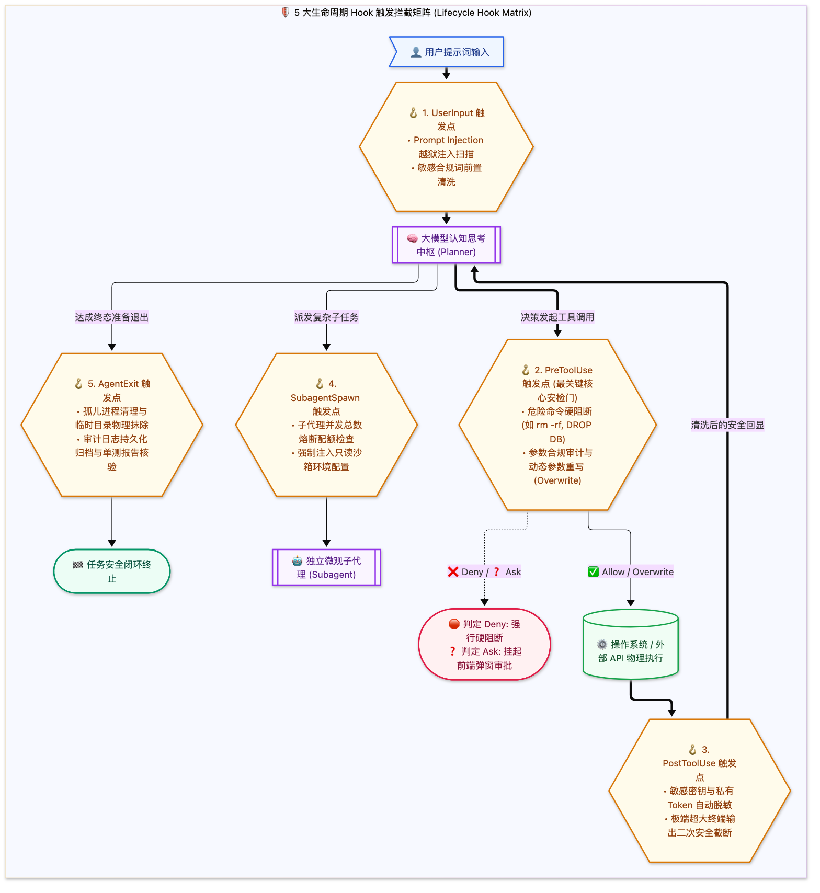

> [📖 返回手册总目录](../README.md) | [← 上一章：09_MCP标准协议架构与微服务集成.md](../02_工具系统与工程实现/09_MCP标准协议架构与微服务集成.md) | [下一章：11_路径父节点向上递归回溯Bubble-up.md →](11_路径父节点向上递归回溯Bubble-up.md)\n\n---\n\n## 第 10 章：为什么 Agent 必须有 Hook？白盒工程控制哲学与 5 大拦截点契约

### 10.1 小白入门通俗理解：智能体操作系统的“海关安检与防火墙”

想象一下：大模型（LLM）是一个充满激情但偶尔会犯糊涂、甚至可能被坏人催眠的飞行员。
* **如果没有任何 Hook（黑盒失控）**：  
  只要大模型嘴里说出一句：“把硬盘清空以便释放空间（`rm -rf /`）”，系统底层二话不说直接执行，你的整台服务器当场暴毙；或者黑客在代码注释里藏了一句诱导指令，模型被催眠后直接将 `.env` 里的数据库密码打包发送到外部黑客服务器。
* **有了生命周期 Hook（白盒工程控制）**：  
  系统的物理执行管道被装上了 **“海关安检闸机”**。大模型可以自由思考、自由提出动作申请，但**在真正调用操作系统底层 API 的前一微秒，动作请求必须被 Hook 拦截下来，放到安检机下白盒透视**。  
  如果安检不通过，无论大模型怎么要求，命令都被绝对物理阻断！

---

### 10.2 五大生命周期 Hook 触发点契约全解

在 Antigravity 等工业级架构中，Hook 贯穿了整个事件循环的 5 个关键生命周期节点：



#### Stdin/Stdout 通信契约规范
所有的 Hook 脚本都独立于主 Agent 进程运行，采用经典的 Unix 管道（`stdin` 接收事件上下文 JSON，`stdout` 输出裁决决策 JSON），实现极致的语言无关性与沙箱安全。

1. **PreToolUse 输入 Payload（通过 stdin 传入 Hook）**：
   ```json
   {
     "hook_event": "PreToolUse",
     "timestamp": "2026-10-17T10:00:00Z",
     "cwd": "/workspace/commercial-ai-drama",
     "tool_name": "run_command",
     "tool_input": {
       "CommandLine": "rm -rf /tmp/cache",
       "Cwd": "/workspace/commercial-ai-drama"
     }
   }
   ```
2. **Hook 裁决返回 Payload（通过 stdout 返回主系统）**：
   ```json
   {
     "verdict": "allow",
     "reason": "目标路径在 /tmp 白名单内，放行执行",
     "overwrite_args": null
   }
   ```\n\n---\n\n> [← 上一章：09_MCP标准协议架构与微服务集成.md](../02_工具系统与工程实现/09_MCP标准协议架构与微服务集成.md) | [📖 返回手册总目录](../README.md) | [下一章：11_路径父节点向上递归回溯Bubble-up.md →](11_路径父节点向上递归回溯Bubble-up.md)\n