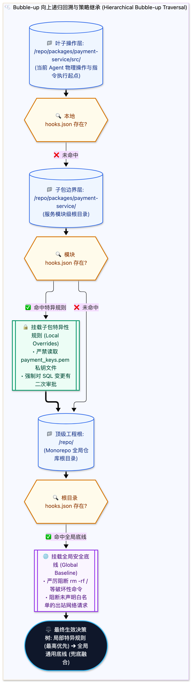

> [📖 返回手册总目录](../README.md) | [← 上一章：10_白盒工程控制与5大拦截点.md](10_白盒工程控制与5大拦截点.md) | [下一章：12_拦截决策矩阵与参数Overwrite重写.md →](12_拦截决策矩阵与参数Overwrite重写.md)\n\n---\n\n## 第 11 章：路径父节点向上递归回溯（Bubble-up）魔法与 Monorepo 多包隔离

### 11.1 小白入门通俗理解：什么是 Bubble-up（向上冒泡）？

* **直观生活类比**：  
  你在一家跨国集团工作，集团总公司有《全集团通用员工行为规范》（例如严禁泄露财务数据）。你所在的部门是“生化实验室”，实验室有更加严苛的《实验室防毒规范》（严禁携带火种、必须穿防护服）。  
  当你在实验室操作台准备点火时，你不仅要遵守实验室的规章，还要遵守总公司的总纲。
* **工程场景类比（Git 的 `.git` 寻找机制）**：  
  当你在终端的深层子目录 `/repo/packages/frontend/src/components/` 敲下 `git status` 时，Git 是怎么知道当前版本库位置的？  
  Git 会先看当前目录有没有 `.git`；没有就看上一级 `src/`，再没有就看 `frontend/`，一路**向上冒泡递归回溯**，直到在根目录 `/repo/` 找到 `.git` 为止。

这就是 **Bubble-up 算法**：当 Agent 在 Monorepo（超大单体多包仓库）中操作一个深层子项目时，系统自动从当前工作目录逐级向上查找并合并安全配置文件（`hooks.json`），实现权限的精准层叠。



---

### 11.2 Bubble-up 路径回溯算法 Python 源码实现

```python
import os
import json
from typing import List, Dict, Any, Optional

def bubble_up_find_hook_configs(start_cwd: str, root_boundary: str) -> List[Dict[str, Any]]:
    """从当前工作目录向上回溯探测 hooks.json，直至抵达 root_boundary 边界"""
    active_configs = []
    current_dir = os.path.abspath(start_cwd)
    root_boundary = os.path.abspath(root_boundary)
    
    while True:
        candidate_hook_file = os.path.join(current_dir, "hooks.json")
        if os.path.isfile(candidate_hook_file):
            print(f"[Bubble-up 发现配置] 探测到 Hook 配置: {candidate_hook_file}")
            with open(candidate_hook_file, "r", encoding="utf-8") as f:
                try:
                    config_data = json.load(f)
                    active_configs.append(config_data)
                except Exception as e:
                    print(f"[!] 解析 {candidate_hook_file} 失败: {e}")
                    
        # 到达工程根目录，终止向上冒泡
        if current_dir == root_boundary or current_dir == os.path.dirname(current_dir):
            break
        current_dir = os.path.dirname(current_dir)
        
    # 按照冒泡顺序，子目录规则排在最前面 (优先级最高)，根目录规则排在最后
    return active_configs
```\n\n---\n\n> [← 上一章：10_白盒工程控制与5大拦截点.md](10_白盒工程控制与5大拦截点.md) | [📖 返回手册总目录](../README.md) | [下一章：12_拦截决策矩阵与参数Overwrite重写.md →](12_拦截决策矩阵与参数Overwrite重写.md)\n