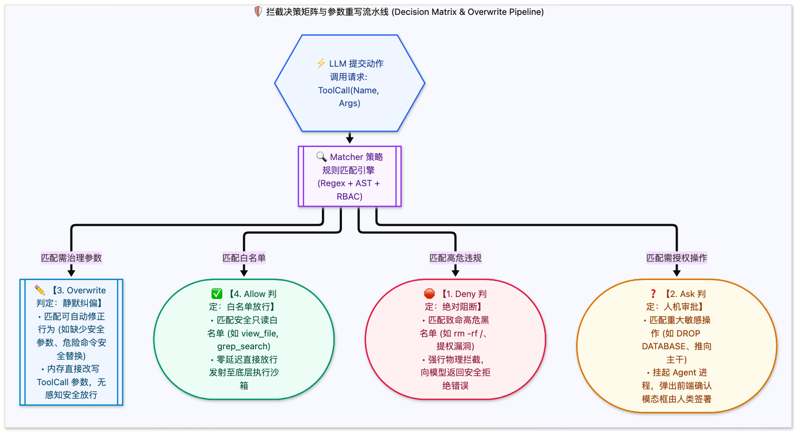

> [📖 返回手册总目录](../README.md) | [← 上一章：11_路径父节点向上递归回溯Bubble-up.md](11_路径父节点向上递归回溯Bubble-up.md) | [下一章：13_Skills物理目录标准与工程规范.md →](../04_规章与Skills模块化工程/13_Skills物理目录标准与工程规范.md)\n\n---\n\n## 第 12 章：拦截决策矩阵：Allow、Deny、Ask 与参数 Overwrite 重写实战

### 12.1 小白入门通俗理解：海关安检的 4 种通行判决

当安检员（Hook 脚本）在 X 光机里看到大模型申请的系统操作时，只能给出以下 4 种严格标准判决：
1. **`allow`（放行通过）**：动作安全合规（如读取普通源码文件），无缝放行，大模型无感知推进；
2. **`deny`（当场阻断并没收）**：动作严重违规（如试图清空生产库），物理硬切断，并向大模型返回冷酷的报错信息，强迫其放弃该企图；
3. **`ask`（呼叫人工主管确认）**：动作有一定风险但属于合法需求（如删除一个无用的分支），智能体挂起等待人类在屏幕前点击“允许”或“拒绝”；
4. **`overwrite`（参数静默纠偏重写）**：**工业级最智慧的操作**！大模型往往会漏掉安全参数，安检员直接在后台把参数替它改好放行（例如大模型执行 `git commit -m 'fix'`，Hook 强制将其重写为 `git commit -m 'fix' --signoff` 以符合合规要求）。

---

### 12.2 参数 Overwrite 重写三大生产实战案例

#### 案例 1：自动将危险的递归强删改写为安全回收站移动
大模型常使用 `rm -rf <path>` 清理临时目录，稍有不慎就会删错目录。Hook 可以在参数层直接将其改写为 Python 安全脚本或移动到 `.trash/` 目录：
* **原始大模型调用**：`run_command(CommandLine="rm -rf /workspace/output/temp")`
* **Hook 重写后实际执行**：`run_command(CommandLine="trash-put /workspace/output/temp")`

#### 案例 2：强制在只读探测中追加 `--dry-run` 标志
当大模型试图执行集群配置变更时，Hook 自动拦截并追加模拟标志，防止直接影响线上资源：
* **原始参数**：`kubectl apply -f deployment.yaml`
* **重写后参数**：`kubectl apply -f deployment.yaml --dry-run=client -o yaml`

#### 案例 3：动态屏蔽代码中的明文密钥（Masking & Redaction）
大模型在编写临时测试脚本时，经常顺手把 `.env` 中的 AWS Secret Key 写死在代码里。Hook 在代码写入磁盘前，自动通过正则扫描发现敏感 Token，将其重写为 `os.environ.get("AWS_SECRET_KEY")`。\n\n---\n\n> [← 上一章：11_路径父节点向上递归回溯Bubble-up.md](11_路径父节点向上递归回溯Bubble-up.md) | [📖 返回手册总目录](../README.md) | [下一章：13_Skills物理目录标准与工程规范.md →](../04_规章与Skills模块化工程/13_Skills物理目录标准与工程规范.md)\n