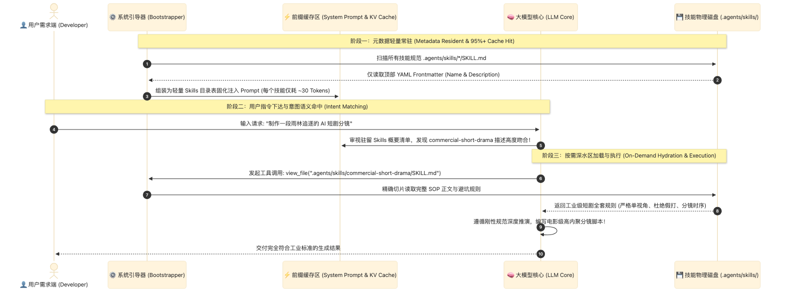

> [📖 返回手册总目录](../README.md) | [← 上一章：13_Skills物理目录标准与工程规范.md](13_Skills物理目录标准与工程规范.md) | [下一章：15_核心辩证_为什么小于100个Skills拒绝Embedding.md →](15_核心辩证_为什么小于100个Skills拒绝Embedding.md)\n\n---\n\n## 第 14 章：YAML Frontmatter 与渐进式披露（Progressive Disclosure）加载时序

### 14.1 小白入门通俗理解：什么是渐进式披露（Progressive Disclosure）？

* **生动生活类比**：  
  你去医院看专科医生，医生的大脑里绝对不会整天一字不差地背诵 50 本厚厚的医学专著。  
  他脑子里常驻的是一本 **“大纲目录”**（心内科、呼吸科、神经科各自看什么病）。当你说“我胸口刺痛、呼吸急促”，医生瞬间检索大纲，从书架上抽出心内科的心电图急救手册（**按需读取详尽 SOP**），开始对症施治。
* **在 AI 智能体中的应用**：  
  如果项目里有 50 个复杂的专业技能（每个技能 500 行 Markdown），如果把它们全部无脑塞进大模型的每一次对话中，不仅上下文当场被垃圾信息淹没，还会导致推理延迟翻倍、费用暴涨。  
  **渐进式披露（Progressive Disclosure）** 就是：**平时只让“技能目录”常驻在大脑里；只有在真正需要执行该任务时，才去把完整的规范正文拿出来看！**

---

### 14.2 渐进式披露的三阶段执行时序图

---

### 14.3 与 Prompt Caching（前缀缓存）的绝妙协同

渐进式披露不仅省上下文，更是 **大模型前缀缓存（Prompt Caching）技术的最大功臣**！  
* 因为所有 Skills 的 YAML Frontmatter 元数据是**完全固定、完全静态的**，它们被排在 System Prompt 的最前部，命中率高达 95% 以上，使得后续每一次调用的输入 Token 成本直接暴降 **90%**，首字响应时间降低 **80%**！\n\n---\n\n> [← 上一章：13_Skills物理目录标准与工程规范.md](13_Skills物理目录标准与工程规范.md) | [📖 返回手册总目录](../README.md) | [下一章：15_核心辩证_为什么小于100个Skills拒绝Embedding.md →](15_核心辩证_为什么小于100个Skills拒绝Embedding.md)\n