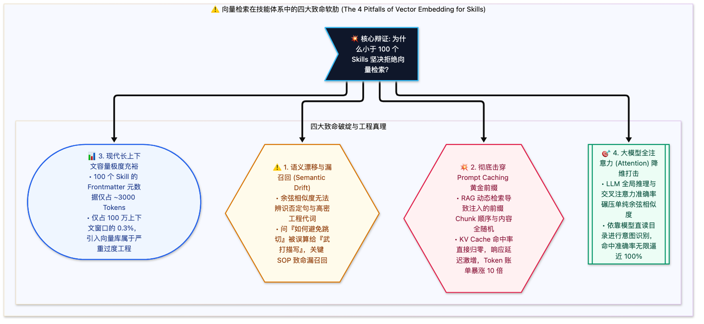

> [📖 返回手册总目录](../README.md) | [← 上一章：14_渐进式披露Progressive_Disclosure加载时序.md](14_渐进式披露Progressive_Disclosure加载时序.md) | [下一章：16_记忆金字塔全景L1到L4.md →](../05_记忆体系全生命周期/16_记忆金字塔全景L1到L4.md)\n\n---\n\n## 第 15 章：核心辩证：为什么 <100 个 Skills 绝对不应该使用 Embedding？

### 15.1 业界的“向量迷信”反模式

很多刚入门的智能体架构师，只要一听到“知识库”或者“技能检索”，就会本能地跳进 RAG 模式：  
* 把每个 Skill 切成 Chunk；
* 扔进 OpenAI / BGE 生成高维向量；
* 存入 Milvus / Chroma 向量数据库；
* 每次用户说话，先做一次余弦相似度检索，把相似度最高的 Chunk 捞出来拼进 Prompt。

**在工业级智能体架构中，对于小于 100 个的 Skills 系统，这种使用 Embedding 的做法是极其拙劣的灾难性反模式！**

---

### 15.2 为什么必须坚决拒绝 Embedding？四大致命破绽剖析

| 维度对比 | 向量检索 (Vector Embedding RAG) | 静态编译 + 渐进式披露 (Progressive Disclosure) |
| :--- | :--- | :--- |
| **召回准确率** | **不可靠 (70% ~ 85%)**，极易被同义词或模糊表述带偏 | **极高 (99%+)**，大模型依靠全局注意力直接推理判定 |
| **缓存命中率 (Prompt Cache)** | **0%** (每次拼接的 Context 完全不同，缓存击穿) | **95%+** (前缀完全静态，命中云端 KV Cache) |
| **首字推理延迟** | **高 (800ms ~ 2000ms)** (外挂向量库网络 IO + 重排耗时) | **极低 (150ms ~ 300ms)** (KV Cache 极速推导) |
| **系统架构复杂度** | **极高** (引入向量库、Embedding 模型、分块策略运维) | **极简 (Zero-Dependency)** (纯原生 Markdown 文件扫描) |

**架构师结论**：  
只有当企业拥有一万个以上的特异性长尾技能时，才值得考虑多级检索路由；在常规工程项目（数十至上百个技能）中，**静态元数据前缀注入 + 大模型主动 `view_file` 渐进式披露** 是当今工业界在准确度、成本、延迟与稳定性上的最优解！\n\n---\n\n> [← 上一章：14_渐进式披露Progressive_Disclosure加载时序.md](14_渐进式披露Progressive_Disclosure加载时序.md) | [📖 返回手册总目录](../README.md) | [下一章：16_记忆金字塔全景L1到L4.md →](../05_记忆体系全生命周期/16_记忆金字塔全景L1到L4.md)\n