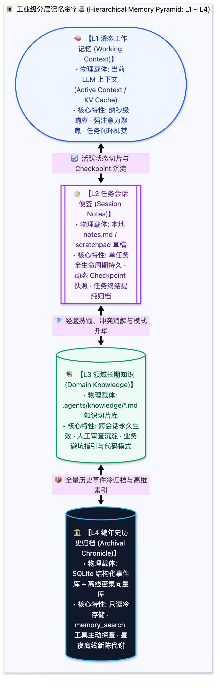

> [📖 返回手册总目录](../README.md) | [← 上一章：15_核心辩证_为什么小于100个Skills拒绝Embedding.md](../04_规章与Skills模块化工程/15_核心辩证_为什么小于100个Skills拒绝Embedding.md) | [下一章：17_三大具象载体Notes_Knowledge_编年史.md →](17_三大具象载体Notes_Knowledge_编年史.md)\n\n---\n\n## 第 16 章：记忆金字塔全景（L1 工作区到 L4 长期存储）：物理载体与生命周期

### 16.1 小白入门通俗理解：人类办公桌记忆模型

如果把智能体的工作过程比作一个专业工程师在办公室里办公：
* **L1 瞬态工作区（Working Memory / Context Window）＝ 电脑显示器屏幕与桌面上的草稿纸**：
  * 大脑正看着这几行代码，手指正敲着键盘。速度极快（纳秒级加载），但**显示器面积有限（Context Window 上限）**，而且一旦关闭程序，屏幕上的内容当场清空；
* **L2 任务便签（Notes / Scratchpad）＝ 贴在显示器边框上的黄色便利贴**：
  * 上面随手记着：“今天上午必须搞定登录鉴权”、“第三步需要把 token 加到 header”。它伴随整个当前任务，任务做完便签撕掉扔进垃圾桶；
* **L3 领域知识库（Domain Knowledge）＝ 办公桌旁触手可及的书架与避坑笔记本**：
  * 记录着跨会话的硬核知识，比如“公司内网网关有 60 秒超时限制”、“这个库在 Python 3.12 下有兼容性 Bug”。不管换谁来办公，这些经验长期有效；
* **L4 编年史档案（Chronicle / Archival Storage）＝ 公司的历史档案大铁柜**：
  * 存放过去三年所有大版本的演进日志、历史事故复盘大报告。平时绝不拿出来占桌面，只有在大审计或追溯历史时才去翻阅。

---

### 16.2 四层记忆的技术规格全景对照表

| 记忆层级 | 典型物理存储介质 | 生命周期与持久化 | 读写成本 | 注入方式 |
| :--- | :--- | :--- | :--- | :--- |
| **L1 瞬态工作区** | GPU/RAM 显存中的 KV Cache | 单次推理或当前控制轮次 | 包含在推理 Token 中 | 直接作为 Prompt 尾部上下文 |
| **L2 任务便签** | `<appDataDir>/brain/notes.md` | 当前复杂任务（数小时至数天） | 极低（纯本地 IO） | 动态切片注入 System Prompt |
| **L3 领域知识库** | `.agents/knowledge/*.md` | 项目全生命周期（永久跨会话） | 低（读多写少） | 渐进式披露或主动检索挂载 |
| **L4 编年史档案** | SQLite + Dense Vector Embeddings | 企业永久知识资产 | 中高（需向量化与检索） | 专属 `memory_search` 工具主动翻找 |\n\n---\n\n> [← 上一章：15_核心辩证_为什么小于100个Skills拒绝Embedding.md](../04_规章与Skills模块化工程/15_核心辩证_为什么小于100个Skills拒绝Embedding.md) | [📖 返回手册总目录](../README.md) | [下一章：17_三大具象载体Notes_Knowledge_编年史.md →](17_三大具象载体Notes_Knowledge_编年史.md)\n