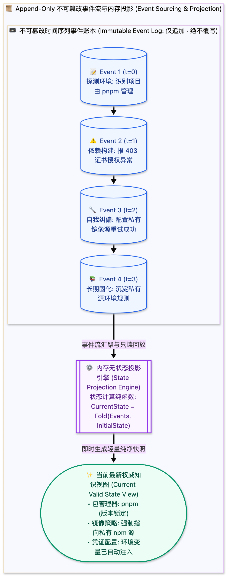

> [📖 返回手册总目录](../README.md) | [← 上一章：17_三大具象载体Notes_Knowledge_编年史.md](17_三大具象载体Notes_Knowledge_编年史.md) | [下一章：19_因果保证_递增ID因果DAG与时间衰减.md →](19_因果保证_递增ID因果DAG与时间衰减.md)\n\n---\n\n## 第 18 章：物理存储载体与事件溯源更新哲学：Append-Only 事件溯源 vs In-place Replace

### 18.1 小白入门通俗理解：为什么智能体绝对不能用“就地修改（In-place Replace）”？

在传统应用开发中，很多程序员习惯于就地修改数据（例如：`UPDATE memory SET content = '新内容' WHERE id = 1`）。  
但在智能体记忆工程中，**就地修改是极其危险的灾难之源**：
* **历史因果彻底蒸发**：如果大模型在第 10 步产生了幻觉，错误地把第 2 步记录的一个核心业务变量改写了，系统将**永远丢失最初的正确记录**，后续所有排查和自愈机制全部失效；
* **没有后悔药**：物理世界是单向流逝的。如果你只存最新快照，当任务失败需要回滚时，你根本不知道“前一秒是什么状态”。

**工业级智能体记忆必须采用“事件溯源（Event Sourcing / Append-Only）”哲学**：  
* **日志永远只能单向追加，严禁就地物理覆盖！**  
* 状态的变更不是通过修改旧数据实现的，而是通过追加一条新事件实现的（例如：追加一条“修正：先前的变量 X 存在歧义，自 Step 12 起以变量 Y 为准”）。  
* **任何时刻的“最新记忆”，都是从第一天起的全量事件流在内存中顺序推演出来的投影（Projection）！**

---

### 18.2 四大物理存储载体分工矩阵

| 载体类型 | 典型工程格式 | 核心适用场景 | 优势与治理权衡 |
| :--- | :--- | :--- | :--- |
| **JSONL (追加日志流)** | `transcript.jsonl` | 轨迹 Trajectory、原始动作回显 | 极快追加（$O(1)$）、流式解析，零锁冲突 |
| **Markdown (结构化文本)** | `notes.md`, `knowledge/*.md` | 人机协同查看、Prompt 注入 | 人类与大模型天然亲和、易于版本控制 |
| **SQLite (嵌入式关系库)** | `state.sqlite3` | 元数据关系映射、递增 ID 序列 | ACID 事务保证、强大的 SQL 结构化关联分析 |
| **Vector DB (向量索引)** | Chroma / LanceDB | 超大规模非结构化文档冷召回 | 纯用于长文本语义关联，禁用于核心控制逻辑 |\n\n---\n\n> [← 上一章：17_三大具象载体Notes_Knowledge_编年史.md](17_三大具象载体Notes_Knowledge_编年史.md) | [📖 返回手册总目录](../README.md) | [下一章：19_因果保证_递增ID因果DAG与时间衰减.md →](19_因果保证_递增ID因果DAG与时间衰减.md)\n