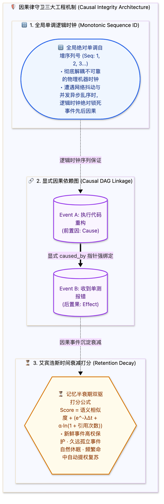

> [📖 返回手册总目录](../README.md) | [← 上一章：18_物理存储载体与事件溯源更新哲学.md](18_物理存储载体与事件溯源更新哲学.md) | [下一章：20_内省武器专属Memory_Search工具.md →](20_内省武器专属Memory_Search工具.md)\n\n---\n\n## 第 19 章：如何绝对保证“事件性”与因果不乱？单调递增 ID、因果 DAG 链与时间衰减打分

### 19.1 小白入门通俗理解：智能体的“时间箭头”与因果律

在分布式或高并发的智能体运行环境中，网络延迟和异步多线程会导致严重的**时间反流（Temporal Inversion）**：  
* 比如 Agent 同时发起了“删除表”和“查询表”两个操作，由于网络抖动，“查询表”的回显居然在“删除表”之后才慢悠悠地返回。如果大模型傻傻地按返回顺序阅读，就会认为“表明明被删除了，为什么还查出了数据？”，从而陷入严重的认知精神分裂。

为了在物理世界里锁死因果律，智能体记忆系统设计了 **两大铁律 + 一大生物钟衰减算法**：



---

### 19.2 艾宾浩斯记忆保留衰减算法 Python 实现

在检索记忆时，一条知识的最终得分由 **语义相似度（Relevance Score）** 与 **时间新鲜度（Retention Score）** 共同加权决定：
$$S_{\text{final}} = w_1 \cdot \text{Sim}(\text{Query}, \text{Memory}) + w_2 \cdot \Big( e^{-\lambda \Delta t} + \alpha \cdot \ln(1 + \text{AccessCount}) \Big)$$

```python
import math
import time

class EbbinghausMemoryScorer:
    def __init__(self, decay_lambda: float = 0.0001, access_alpha: float = 0.15):
        self.decay_lambda = decay_lambda  # 时间衰减半衰期因子
        self.access_alpha = access_alpha  # 重复提取强化系数

    def calculate_retention(self, created_timestamp: float, access_count: int) -> float:
        """计算单条记忆在当前时刻的留存权重 (0.0 ~ 1.0+)"""
        delta_seconds = max(0.0, time.time() - created_timestamp)
        # 基础艾宾浩斯指数衰减
        base_retention = math.exp(-self.decay_lambda * delta_seconds)
        # 检索频率强化 (经常被想起的事情不容易遗忘)
        frequency_boost = self.access_alpha * math.log(1 + access_count)
        
        return min(1.0, base_retention + frequency_boost)
```\n\n---\n\n> [← 上一章：18_物理存储载体与事件溯源更新哲学.md](18_物理存储载体与事件溯源更新哲学.md) | [📖 返回手册总目录](../README.md) | [下一章：20_内省武器专属Memory_Search工具.md →](20_内省武器专属Memory_Search工具.md)\n