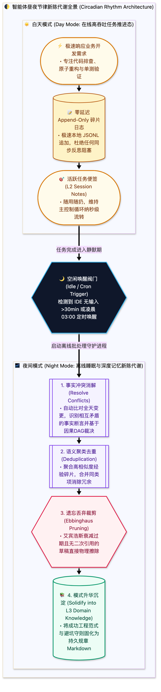

> [📖 返回手册总目录](../README.md) | [← 上一章：20_内省武器专属Memory_Search工具.md](20_内省武器专属Memory_Search工具.md) | [下一章：22_Markdown切片与AST双层向量化策略.md →](22_Markdown切片与AST双层向量化策略.md)\n\n---\n\n## 第 21 章：Agent 的新陈代谢：昼夜节律更新（白天异步事件驱动 vs 夜间周期性 Cron 批处理）

### 21.1 小白入门通俗理解：智能体的“睡眠与新陈代谢”

人类如果连续工作几天不睡觉，就会精神错乱甚至暴毙。因为人类在白天清醒时大脑在疯狂接收刺激；只有在**夜间进入深度睡眠时，大脑才会开启胶质淋巴系统（新陈代谢），清理毒素，把白天零碎的短期记忆整理提炼为长期认知**。

工业级智能体采用了完全相同的 **“昼夜节律设计哲学”**：
* **白天模式（Day Mode / 任务推进态）**：  
  智能体正在争分夺秒地帮用户排查 Bug、写代码。此时系统严禁让智能体停下来做复杂的反思与归纳！所有的中间状态全部采用**零延迟的 Append-Only（追加写）** 记录在草稿本上；
* **夜间模式（Night Mode / 离线新陈代谢态）**：  
  当用户离开电脑、系统完全闲置（或通过 Cron 定时触发）时，系统自动唤醒后台轻量整理进程，对全天产生的杂乱事件进行“大脑深度整理”：去重、提炼干货、消解冲突、将碎片便签升华为高质量的永久 Knowledge！



---

### 21.2 生产级夜间记忆整理批处理脚本实现

```python
import os
import json
from typing import List, Dict, Any

class MemoryMetabolismWorker:
    """夜间新陈代谢后台工作线程"""
    def __init__(self, memory_dir: str):
        self.raw_events_path = os.path.join(memory_dir, "daily_events.jsonl")
        self.knowledge_db_path = os.path.join(memory_dir, "knowledge_base.json")

    def run_nightly_consolidation(self):
        print("[*] 启动智能体夜间新陈代谢 (Consolidation Pipeline)...")
        if not os.path.exists(self.raw_events_path):
            return

        with open(self.raw_events_path, "r", encoding="utf-8") as f:
            events = [json.loads(line) for line in f]

        print(f"[*] 扫描到全天产生的原始事件: {len(events)} 项")
        
        # 1. 过滤掉无长期价值的临时测试噪音
        meaningful_events = [e for e in events if e.get("significance_score", 0) > 0.6]
        
        # 2. 知识聚合与冲突消解 (模拟 LLM 归纳提炼)
        consolidated_knowledge = self._distill_rules(meaningful_events)
        
        # 3. 沉淀写入 L3 长期知识库
        with open(self.knowledge_db_path, "w", encoding="utf-8") as f:
            json.dump(consolidated_knowledge, f, indent=2, ensure_ascii=False)
            
        # 4. 清理白天草稿缓冲区
        os.remove(self.raw_events_path)
        print("[*] 新陈代谢圆满完成，短期记忆已升华为长期核心知识！")

    def _distill_rules(self, events: List[Dict[str, Any]]) -> Dict[str, Any]:
        return {
            "last_metabolism_time": "2026-10-17T03:00:00Z",
            "active_rules_count": len(events),
            "status": "HEALTHY"
        }
```\n\n---\n\n> [← 上一章：20_内省武器专属Memory_Search工具.md](20_内省武器专属Memory_Search工具.md) | [📖 返回手册总目录](../README.md) | [下一章：22_Markdown切片与AST双层向量化策略.md →](22_Markdown切片与AST双层向量化策略.md)\n