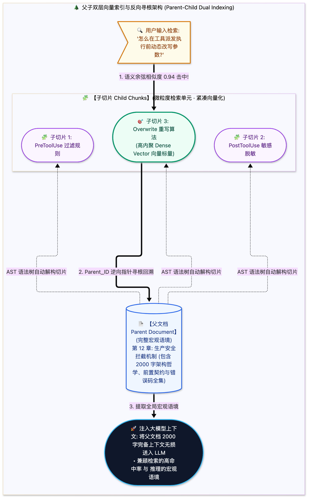

> [📖 返回手册总目录](../README.md) | [← 上一章：21_昼夜节律更新白天异步与夜间Cron批处理.md](21_昼夜节律更新白天异步与夜间Cron批处理.md) | [下一章：23_System_Prompt六大拼图与前缀缓存.md →](../06_系统提示词与意图识别/23_System_Prompt六大拼图与前缀缓存.md)\n\n---\n\n## 第 22 章：Markdown 切片与 Embedding 向量化策略：Header 切分与父子双层向量

### 22.1 小白入门通俗理解：为什么不能按字符数“暴力切片”？

在传统的简易 RAG 教学中，经常能看到一种极其业余的做法：  
* `text_splitter = CharacterTextSplitter(chunk_size=500, chunk_overlap=50)`  
* 这种做法不管三七二十一，每隔 500 个字符就拿刀狠狠切一刀！

**在代码与技术规章中，这种暴力切块是彻底的灾难**：
* 你的一个 `if-else` 判断语句、一段严密的逻辑因果、或者一个 Markdown 表格，可能恰好被从正中间一刀砍成两半！
* 模型检索到上半截时，根本不知道下半截的限制条件；检索到下半截时，连主语是谁都不知道。

**工业级切片方案：基于 AST（抽象语法树）的 Markdown Header 语义层级切分**！  
按照 `#`、`##`、`###` 标题的自然边界进行切片，确保每个小节（Section）保持完整的上下文独立性！

---

### 22.2 父子双层向量索引（Parent-Child Dual Indexing）

为了解决“**检索需要精炼向量，推理需要宏观背景**”的矛盾，工业级方案引入了父子双层索引结构：
1. **子切片（Child Chunk / 检索单元）**：将具体的操作步骤或代码段生成向量，用于在向量空间被精准命中；
2. **父切片（Parent Document / 上下文注入单元）**：一旦某个子切片被高分命中，系统**并不只把这几句话塞给大模型，而是把它的整个父章节（包含前言、背景与限制条件）完整提取出来注入 Prompt**！

\n\n---\n\n> [← 上一章：21_昼夜节律更新白天异步与夜间Cron批处理.md](21_昼夜节律更新白天异步与夜间Cron批处理.md) | [📖 返回手册总目录](../README.md) | [下一章：23_System_Prompt六大拼图与前缀缓存.md →](../06_系统提示词与意图识别/23_System_Prompt六大拼图与前缀缓存.md)\n