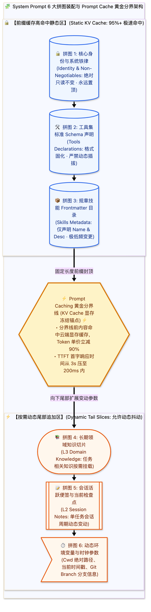

> [📖 返回手册总目录](../README.md) | [← 上一章：22_Markdown切片与AST双层向量化策略.md](../05_记忆体系全生命周期/22_Markdown切片与AST双层向量化策略.md) | [下一章：24_用户意图全景分类体系三维模型.md →](24_用户意图全景分类体系三维模型.md)\n\n---\n\n## 第 23 章：System Prompt 6 大注入拼图与 Prompt Caching 前缀缓存技术

### 23.1 小白入门通俗理解：智能体的“灵魂出厂设置与拼图排列学”

如果你把大模型想象成一个刚走进办公室的超级新员工：
* **System Prompt（系统提示词）** 就是你递给他的 **“员工入职手册与作战总指挥简报”**。  
  它决定了智能体是谁（身份）、必须遵守哪些法律红线（安全准则）、手头有哪些工具可用（工具集）、当前正在解决什么任务（便签）。
* **但是，很多人不知道拼图顺序有多重要**！  
  如果你的入职手册第一句话写着当前时间：“今天是 2026 年 10 月 17 日 10 点 01 分 03 秒”；到了下一秒，时间变成了 04 秒。  
  **大模型云端服务器的显存缓存（KV Cache）会从第一个变动的字开始彻底失效**！每一次交互，云端都必须把后面几十万字重新做一次极其昂贵的矩阵乘法计算！  
  这就是为什么工业级 System Prompt 必须遵循严格的 **“从绝对静态到完全动态” 的拼图装配学**！

---

### 23.2 Prompt Caching 前缀缓存的工业级收益

当大模型服务商（如 Google Gemini、Anthropic Claude）支持 Prompt Caching 时：
* **缓存命中（Cache Read）的 Token 单价通常只有正常输入价格的 10%**；
* 首字输出时间（Time-to-First-Token, TTFT）从 2~4 秒暴降到 **200 毫秒以内**！
* 保证静态拼图在前、动态拼图在后，是工业级 Agent 降本 90% 的第一核心铁律。\n\n---\n\n> [← 上一章：22_Markdown切片与AST双层向量化策略.md](../05_记忆体系全生命周期/22_Markdown切片与AST双层向量化策略.md) | [📖 返回手册总目录](../README.md) | [下一章：24_用户意图全景分类体系三维模型.md →](24_用户意图全景分类体系三维模型.md)\n