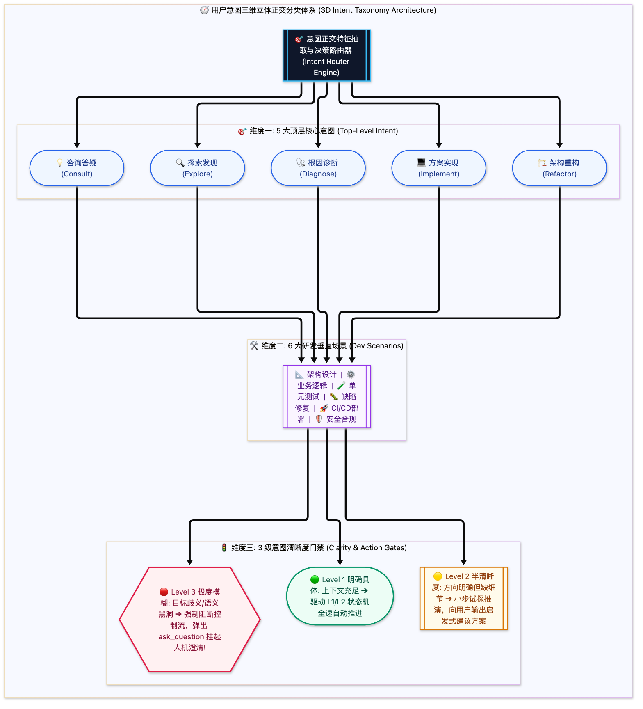

> [📖 返回手册总目录](../README.md) | [← 上一章：23_System_Prompt六大拼图与前缀缓存.md](23_System_Prompt六大拼图与前缀缓存.md) | [下一章：25_工业级护城河死循环熔断沙箱与受限解码.md →](../07_高可用与前沿演进/25_工业级护城河死循环熔断沙箱与受限解码.md)\n\n---\n\n## 第 24 章：用户意图全景分类体系：5 大顶层意图 × 6 大研发场景 × 3 级清晰度

### 24.1 小白入门通俗理解：把用户的一句话进行“三维立体解构”

很多初学者做的 Agent 之所以显得“笨拙、爱添乱、乱改代码”，根本原因在于它把用户的每一句话都当成了“立刻改代码”。  
比如用户说了一句：“这个支付接口怎么总是报 403 呢？”  
* **愚蠢的 Agent**：二话不说，上去就把支付接口的代码删了重写，越改越乱；
* **成熟的工业级 Agent**：首先对这句话进行 **三维立体雷达解构**：
  1. 用户的顶层意图是“诊断答疑”，不是“重构重写”；
  2. 研发场景属于“缺陷排查”，应该调只读工具抓日志，严禁私自修改生产文件；
  3. 清晰度属于“半清晰（Level 2）”，还缺少关键入参，应该列出两个最可能的排查方向供用户确认。



---

### 24.2 模糊意图自愈门禁：`ask_question` 交互模态契约

当意图识别判定清晰度为 **Level 3（极度模糊）** 时，系统**严禁让模型自由脑补发散**，强制触发交互阻断：
* 典型模糊输入：“帮我把这个项目优化一下”；
* 触发动作：挂起运行循环，前端渲染单选/多选模态框：
  ```text
  问题：您所说的『优化』主要侧重于以下哪个方向？
  [ ] 1. 性能优化 (数据库查询索引与前端包体积压缩)
  [ ] 2. 代码重构 (提取公用组件与消除重复逻辑)
  [ ] 3. 安全加固 (修复依赖漏洞与加强接口鉴权)
  ```
用户点击确认后，意图清晰度瞬间收敛为 Level 1，Agent 精准开工！\n\n---\n\n> [← 上一章：23_System_Prompt六大拼图与前缀缓存.md](23_System_Prompt六大拼图与前缀缓存.md) | [📖 返回手册总目录](../README.md) | [下一章：25_工业级护城河死循环熔断沙箱与受限解码.md →](../07_高可用与前沿演进/25_工业级护城河死循环熔断沙箱与受限解码.md)\n