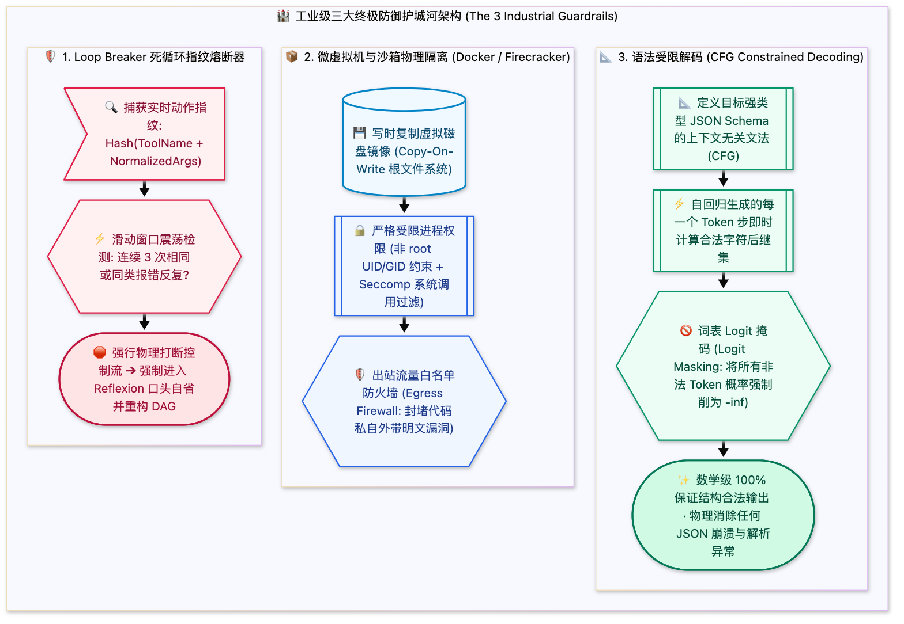

> [📖 返回手册总目录](../README.md) | [← 上一章：24_用户意图全景分类体系三维模型.md](../06_系统提示词与意图识别/24_用户意图全景分类体系三维模型.md) | [下一章：附录A_7大Step_Types生产级JSON载荷全解.md →](../08_附录篇与实战源码/附录A_7大Step_Types生产级JSON载荷全解.md)\n\n---\n\n## 第 25 章：工业级护城河：死循环自愈熔断器、安全沙箱与语法受限解码（CFG）

### 25.1 小白入门通俗理解：防翻车的三道终极钢铁防线

在生产环境中，你绝不能指望大模型“永远不犯错”。工业级系统之所以稳定，是因为它拥有三道铁打的护城河：
1. **死循环自愈熔断器（Loop Breaker）＝“防撞自刹车系统”**：  
   当大模型改错了一行代码导致单测报错，它很可能会尝试第 2 次、第 3 次、甚至第 20 次盲目瞎试，把所有的 Token 额度在 5 分钟内烧光。熔断器发现动作指纹重复，就像汽车防撞雷达一样，强制一脚踩死刹车！
2. **安全沙箱隔离（Sandboxing）＝“防爆防辐射实验室”**：  
   智能体执行的所有终端命令，都在一个随时可以抛弃销毁的容器或虚拟机里运行。就算它执行了格式化命令，炸掉的也只是一个虚拟沙箱，宿主机的真实代码毫发无伤；
3. **语法受限解码（Constrained Decoding / CFG）＝“从物理层保证 100% 正确输出”**：  
   很多初学者以为保证模型输出合法 JSON 靠在 Prompt 里反复叮嘱“千万不要输出 Markdown、只输出 JSON”。这完全是靠天吃饭！工业级系统在底层芯片生成字符的纳秒瞬间，直接把所有不合法字符的概率强制削成 0，从数学物理层面保证 100% 格式合法！



---

### 25.2 Loop Breaker 动作指纹检测 Python 核心实现

```python
import hashlib
import json
from typing import List, Dict, Any

class LoopBreaker:
    def __init__(self, max_allowed_repeats: int = 3):
        self.max_allowed_repeats = max_allowed_repeats
        self.history_window: List[str] = []

    def compute_action_fingerprint(self, tool_name: str, arguments: Dict[str, Any]) -> str:
        """将工具调用参数归一化并计算 MD5 动作指纹"""
        # 排除随机变化的毫秒时间戳等扰动字段
        clean_args = {k: v for k, v in arguments.items() if "time" not in k.lower()}
        serialized = f"{tool_name}:{json.dumps(clean_args, sort_keys=True)}"
        return hashlib.md5(serialized.encode("utf-8")).hexdigest()

    def check_and_record(self, tool_name: str, arguments: Dict[str, Any]) -> bool:
        """检测是否触碰死循环熔断线。返回 True 表示安全，返回 False 表示触发熔断"""
        fingerprint = self.compute_action_fingerprint(tool_name, arguments)
        self.history_window.append(fingerprint)
        
        # 只保留最近 10 步滑动窗口
        if len(self.history_window) > 10:
            self.history_window.pop(0)

        repeat_count = self.history_window.count(fingerprint)
        if repeat_count >= self.max_allowed_repeats:
            print(f"[!] 🚨 触发死循环熔断报警！动作指纹 {fingerprint[:8]} 在近期窗口重复出现 {repeat_count} 次！")
            return False  # 必须立刻阻断并要求反思
        return True
```\n\n---\n\n> [← 上一章：24_用户意图全景分类体系三维模型.md](../06_系统提示词与意图识别/24_用户意图全景分类体系三维模型.md) | [📖 返回手册总目录](../README.md) | [下一章：附录A_7大Step_Types生产级JSON载荷全解.md →](../08_附录篇与实战源码/附录A_7大Step_Types生产级JSON载荷全解.md)\n