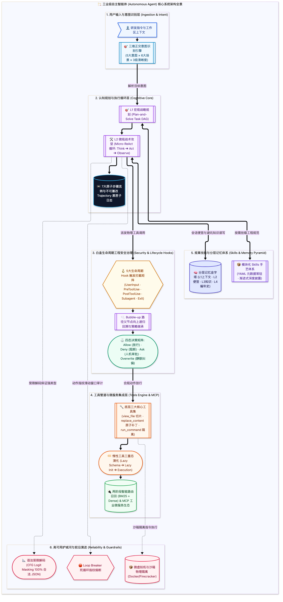

# 工业级 AI Agent 架构与核心实现全景技术手册（终极详解典藏版）

> **系统工程定位**：面向工业级自主智能体（Autonomous Agents）架构师与高级研发者的深度底层技术白皮书。  
> **内容准则**：全面覆盖智能体执行循环、工具管道、安全 Hook、规章 Skills、四层记忆金字塔、系统提示词工程与可靠性护城河。彻底摒弃通用教材废话，对齐生产环境真实实现。

---

## 🏗️ 工业级 Agent 整体架构全景



---

## 📂 模块化目录结构（按篇章分目录呈现）

本书已按照章节逻辑划分为 **8 个篇章独立文件夹**，每个文件夹均配备独立的 `README.md` 篇章导读，章节间支持顺序无缝平滑跳转：

```text
agent/
├── README.md                                          # 📖 本手册全局总目录
├── 01_认知核心与运行循环/                               # 篇章一：认知模型与运行循环
│   ├── README.md                                      # 篇章导读
│   ├── 01_Agent本质与多架构混合体制.md
│   ├── 02_7大Step_Types生产级Schema全解.md
│   └── 03_全生命周期轨迹Trajectory建模.md
├── 02_工具系统与工程实现/                               # 篇章二：工具系统与工程实现
│   ├── README.md                                      # 篇章导读
│   ├── 04_核心工具集底层执行机制.md
│   ├── 05_工具安全分级与并发执行管道.md
│   ├── 06_惰性工具Lazy_Tools三重态.md
│   ├── 07_高阶工具范式元工具与宏工具.md
│   ├── 08_海量工具动态发现与两阶段路由.md
│   └── 09_MCP标准协议架构与微服务集成.md
├── 03_生命周期Hook安全拦截/                             # 篇章三：Hook安全拦截守卫
│   ├── README.md                                      # 篇章导读
│   ├── 10_白盒工程控制与5大拦截点.md
│   ├── 11_路径父节点向上递归回溯Bubble-up.md
│   └── 12_拦截决策矩阵与参数Overwrite重写.md
├── 04_规章与Skills模块化工程/                           # 篇章四：规章与Skills模块化
│   ├── README.md                                      # 篇章导读
│   ├── 13_Skills物理目录标准与工程规范.md
│   ├── 14_渐进式披露Progressive_Disclosure加载时序.md
│   └── 15_核心辩证_为什么小于100个Skills拒绝Embedding.md
├── 05_记忆体系全生命周期/                               # 篇章五：分层记忆全生命周期
│   ├── README.md                                      # 篇章导读
│   ├── 16_记忆金字塔全景L1到L4.md
│   ├── 17_三大具象载体Notes_Knowledge_编年史.md
│   ├── 18_物理存储载体与事件溯源更新哲学.md
│   ├── 19_因果保证_递增ID因果DAG与时间衰减.md
│   ├── 20_内省武器专属Memory_Search工具.md
│   ├── 21_昼夜节律更新白天异步与夜间Cron批处理.md
│   └── 22_Markdown切片与AST双层向量化策略.md
├── 06_系统提示词与意图识别/                             # 篇章六：提示词工程与意图分类
│   ├── README.md                                      # 篇章导读
│   ├── 23_System_Prompt六大拼图与前缀缓存.md
│   └── 24_用户意图全景分类体系三维模型.md
├── 07_高可用与前沿演进/                                 # 篇章七：可靠性与前沿演进
│   ├── README.md                                      # 篇章导读
│   └── 25_工业级护城河死循环熔断沙箱与受限解码.md
└── 08_附录篇与实战源码/                                 # 附录：生产配置与实战源码
    ├── README.md                                      # 篇章导读
    ├── 附录A_7大Step_Types生产级JSON载荷全解.md
    ├── 附录B_完整Minimal_Industrial_Agent源码.md
    ├── 附录C_生产级hooks_json与安全脚本配置.md
    ├── 附录D_生产级System_Prompt工程模版.md
    └── 附录E_Agent十大反模式与治理速查表.md
```

---

## 📑 章节总览与直达导航

### [第一篇：智能体认知模型与运行循环 (Cognitive Core & Event Loop)](01_认知核心与运行循环/README.md)

探讨现代工业级 Agent 认知中枢，解构其如何从传统无状态概率采样跃迁为有状态闭环控制系统，并对底层 7 大原子步骤与全生命周期黑匣子轨迹（Trajectory）展开深入剖析。

| 章节文件 | 核心技术专题 |
| :--- | :--- |
| [01_Agent本质与多架构混合体制.md](01_认知核心与运行循环/01_Agent本质与多架构混合体制.md) | 第 1 章：Agent 的本质与执行循环：LLM vs Agent 与多架构混合并用体制 |
| [02_7大Step_Types生产级Schema全解.md](01_认知核心与运行循环/02_7大Step_Types生产级Schema全解.md) | 第 2 章：运行时的最小原子：7 大 Step Types 生产级 Schema 全解 |
| [03_全生命周期轨迹Trajectory建模.md](01_认知核心与运行循环/03_全生命周期轨迹Trajectory建模.md) | 第 3 章：全生命周期轨迹（Trajectory）建模：状态流转、因果审计与“黑匣子”恢复 |

---

### [第二篇：工具系统（Tools）的工程全景与实现技术 (Tools System Architecture)](02_工具系统与工程实现/README.md)

深入剖析核心工具（Core Tools）参数边界与执行管道、惰性工具（Lazy Tools）三重态、海量工具两阶段路由与 MCP 标准微服务集成。

| 章节文件 | 核心技术专题 |
| :--- | :--- |
| [04_核心工具集底层执行机制.md](02_工具系统与工程实现/04_核心工具集底层执行机制.md) | 第 4 章：核心工具集（Core Tools）：view_file、replace_file_content 与 run_command 底层执行 |
| [05_工具安全分级与并发执行管道.md](02_工具系统与工程实现/05_工具安全分级与并发执行管道.md) | 第 5 章：工具安全分级与并发执行管道：Read/Write 隔离与并行调度 |
| [06_惰性工具Lazy_Tools三重态.md](02_工具系统与工程实现/06_惰性工具Lazy_Tools三重态.md) | 第 6 章：惰性工具（Lazy Tools）三重态：Schema 注册、按需 Init 与执行态流转 |
| [07_高阶工具范式元工具与宏工具.md](02_工具系统与工程实现/07_高阶工具范式元工具与宏工具.md) | 第 7 章：高阶工具范式：元工具、组合宏工具、瞬态草稿与影子工具 |
| [08_海量工具动态发现与两阶段路由.md](02_工具系统与工程实现/08_海量工具动态发现与两阶段路由.md) | 第 8 章：海量工具动态发现（Discovery）与两阶段路由机制 |
| [09_MCP标准协议架构与微服务集成.md](02_工具系统与工程实现/09_MCP标准协议架构与微服务集成.md) | 第 9 章：MCP（Model Context Protocol）标准协议架构与微服务集成 |

---

### [第三篇：生命周期 Hook 系统（安全中间件与拦截守卫）(Lifecycle Hooks & Guardrails)](03_生命周期Hook安全拦截/README.md)

解密工业级白盒工程控制哲学，深入 5 大生命周期 Hook 触发点契约、Bubble-up 父节点回溯算法与 Allow/Deny/Ask/Overwrite 拦截决策矩阵。

| 章节文件 | 核心技术专题 |
| :--- | :--- |
| [10_白盒工程控制与5大拦截点.md](03_生命周期Hook安全拦截/10_白盒工程控制与5大拦截点.md) | 第 10 章：为什么 Agent 必须有 Hook？白盒工程控制哲学与 5 大拦截点契约 |
| [11_路径父节点向上递归回溯Bubble-up.md](03_生命周期Hook安全拦截/11_路径父节点向上递归回溯Bubble-up.md) | 第 11 章：路径父节点向上递归回溯（Bubble-up）魔法与 Monorepo 多包隔离 |
| [12_拦截决策矩阵与参数Overwrite重写.md](03_生命周期Hook安全拦截/12_拦截决策矩阵与参数Overwrite重写.md) | 第 12 章：拦截决策矩阵：Allow、Deny、Ask 与参数 Overwrite 重写实战 |

---

### [第四篇：规章与手艺系统（Skills 模块化工程）(Skills Engineering & Progressive Disclosure)](04_规章与Skills模块化工程/README.md)

剖析 Skills 物理标准目录、YAML Frontmatter 渐进式披露（Progressive Disclosure）加载时序，以及为什么 <100 个 Skills 绝对不应该使用 Embedding 的架构辩证。

| 章节文件 | 核心技术专题 |
| :--- | :--- |
| [13_Skills物理目录标准与工程规范.md](04_规章与Skills模块化工程/13_Skills物理目录标准与工程规范.md) | 第 13 章：Skills 的物理目录标准与工程规范：SKILL.md、scripts 与 references |
| [14_渐进式披露Progressive_Disclosure加载时序.md](04_规章与Skills模块化工程/14_渐进式披露Progressive_Disclosure加载时序.md) | 第 14 章：YAML Frontmatter 与渐进式披露（Progressive Disclosure）时序 |
| [15_核心辩证_为什么小于100个Skills拒绝Embedding.md](04_规章与Skills模块化工程/15_核心辩证_为什么小于100个Skills拒绝Embedding.md) | 第 15 章：核心辩证：为什么 <100 个 Skills 绝对不应该使用 Embedding？ |

---

### [第五篇：记忆体系全生命周期（Agent Memory Architecture）](05_记忆体系全生命周期/README.md)

解构 L1 到 L4 记忆金字塔全景、三大具象载体（便签、知识、编年史）、事件溯源 Append-only、单调递增 ID、Memory Search 专属工具与昼夜节律新陈代谢。

| 章节文件 | 核心技术专题 |
| :--- | :--- |
| [16_记忆金字塔全景L1到L4.md](05_记忆体系全生命周期/16_记忆金字塔全景L1到L4.md) | 第 16 章：记忆金字塔全景（L1 工作区到 L4 长期存储）：物理载体与生命周期 |
| [17_三大具象载体Notes_Knowledge_编年史.md](05_记忆体系全生命周期/17_三大具象载体Notes_Knowledge_编年史.md) | 第 17 章：三大核心具象载体深度解析：Notes（便签）、Knowledge（知识）、编年史（Chronicle） |
| [18_物理存储载体与事件溯源更新哲学.md](05_记忆体系全生命周期/18_物理存储载体与事件溯源更新哲学.md) | 第 18 章：物理存储载体与记忆更新哲学：Append-Only 事件溯源 vs In-place Replace |
| [19_因果保证_递增ID因果DAG与时间衰减.md](05_记忆体系全生命周期/19_因果保证_递增ID因果DAG与时间衰减.md) | 第 19 章：如何绝对保证“事件性”与因果不乱？单调递增 ID、因果 DAG 链与时间衰减打分 |
| [20_内省武器专属Memory_Search工具.md](05_记忆体系全生命周期/20_内省武器专属Memory_Search工具.md) | 第 20 章：内省武器：专属 Memory Search 工具（主动翻找 vs 被动联想） |
| [21_昼夜节律更新白天异步与夜间Cron批处理.md](05_记忆体系全生命周期/21_昼夜节律更新白天异步与夜间Cron批处理.md) | 第 21 章：Agent 的新陈代谢：昼夜节律更新（白天异步事件驱动 vs 夜间周期性 Cron 批处理） |
| [22_Markdown切片与AST双层向量化策略.md](05_记忆体系全生命周期/22_Markdown切片与AST双层向量化策略.md) | 第 22 章：Markdown 切片与 Embedding 向量化策略：Header 切分与父子双层向量 |

---

### [第六篇：系统提示词工程与意图识别（System Prompt & Intent Routing）](06_系统提示词与意图识别/README.md)

剖析 System Prompt 6 大注入拼图、Prompt Caching 前缀缓存技术与用户意图三维分类体系（5 大意图 × 6 大研发场景 × 3 级清晰度）。

| 章节文件 | 核心技术专题 |
| :--- | :--- |
| [23_System_Prompt六大拼图与前缀缓存.md](06_系统提示词与意图识别/23_System_Prompt六大拼图与前缀缓存.md) | 第 23 章：System Prompt 6 大注入拼图与 Prompt Caching 前缀缓存技术 |
| [24_用户意图全景分类体系三维模型.md](06_系统提示词与意图识别/24_用户意图全景分类体系三维模型.md) | 第 24 章：用户意图全景分类体系：5 大顶层意图 × 6 大研发场景 × 3 级清晰度 |

---

### [第七篇：工业级高可用、安全防翻车与前沿演进 (Reliability & Frontiers)](07_高可用与前沿演进/README.md)

死循环自愈熔断器（Loop Breaker）、沙箱隔离、间接提示词注入防御、确定性状态图机与语法受限解码（CFG）。

| 章节文件 | 核心技术专题 |
| :--- | :--- |
| [25_工业级护城河死循环熔断沙箱与受限解码.md](07_高可用与前沿演进/25_工业级护城河死循环熔断沙箱与受限解码.md) | 第 25 章：工业级护城河：死循环自愈熔断器、安全沙箱与语法受限解码（CFG） |

---

### [附录篇：工业级全套实现代码与生产配置库 (Appendices & Codebases)](08_附录篇与实战源码/README.md)

提供 7 大 Step Types 生产级真实 JSON 载荷、300 行端到端完整 Python 原型代码、hooks.json 配置实战、生产级 System Prompt 工程模版与 10 大反模式治理速查表。

| 章节文件 | 核心技术专题 |
| :--- | :--- |
| [附录A_7大Step_Types生产级JSON载荷全解.md](08_附录篇与实战源码/附录A_7大Step_Types生产级JSON载荷全解.md) | 附录 A：7 大 Step Types 真实生产 JSON 载荷全解 |
| [附录B_完整Minimal_Industrial_Agent源码.md](08_附录篇与实战源码/附录B_完整Minimal_Industrial_Agent源码.md) | 附录 B：完整可运行的 Minimal Industrial Agent 源码（Python 原型） |
| [附录C_生产级hooks_json与安全脚本配置.md](08_附录篇与实战源码/附录C_生产级hooks_json与安全脚本配置.md) | 附录 C：生产级 hooks.json 与安全拦截脚本完整配置 |
| [附录D_生产级System_Prompt工程模版.md](08_附录篇与实战源码/附录D_生产级System_Prompt工程模版.md) | 附录 D：生产级 System Prompt 真实工程模版 |
| [附录E_Agent十大反模式与治理速查表.md](08_附录篇与实战源码/附录E_Agent十大反模式与治理速查表.md) | 附录 E：Agent 10 大反模式与架构级治理全景速查表 |

---

## 🚀 推荐阅读路径

1. **宏观认知与架构入门**：先阅读 [`01_认知核心与运行循环/01_Agent本质与多架构混合体制.md`](01_认知核心与运行循环/01_Agent本质与多架构混合体制.md) 与 [`01_认知核心与运行循环/02_7大Step_Types生产级Schema全解.md`](01_认知核心与运行循环/02_7大Step_Types生产级Schema全解.md)；
2. **工具调度与外部系统对接**：阅读 [`02_工具系统与工程实现/`](02_工具系统与工程实现/README.md)（核心工具底层机制、惰性工具三重态、MCP 协议）；
3. **企业级白盒安全控制**：精读 [`03_生命周期Hook安全拦截/`](03_生命周期Hook安全拦截/README.md)（Hook 拦截点、Bubble-up 算法、参数改写）；
4. **规章规范渐进式披露**：精读 [`04_规章与Skills模块化工程/`](04_规章与Skills模块化工程/README.md)；
5. **记忆系统与因果一致性**：研读 [`05_记忆体系全生命周期/`](05_记忆体系全生命周期/README.md)（L1~L4 记忆金字塔、事件溯源、昼夜节律更新）；
6. **实战代码动手实践**：查阅 [`08_附录篇与实战源码/附录B_完整Minimal_Industrial_Agent源码.md`](08_附录篇与实战源码/附录B_完整Minimal_Industrial_Agent源码.md)。
